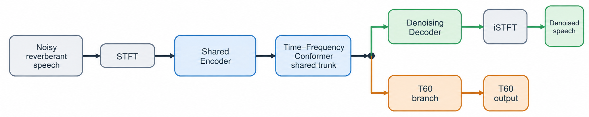
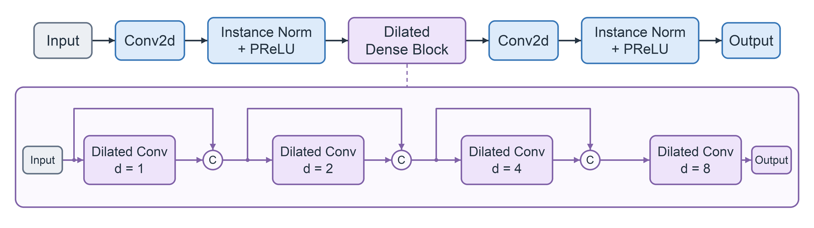
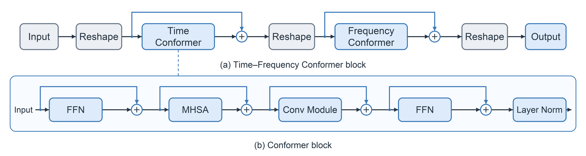
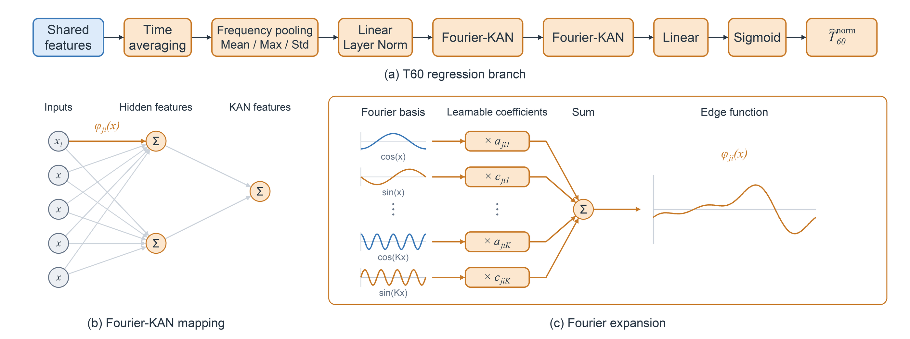
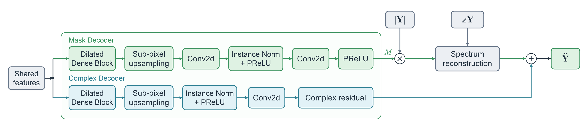
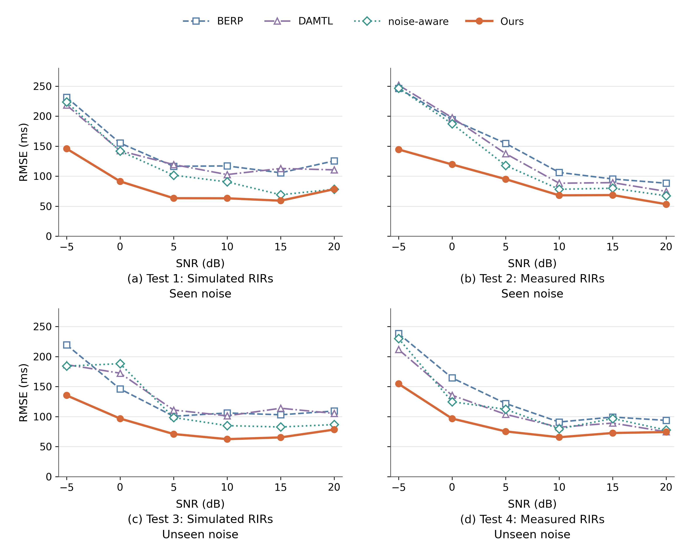
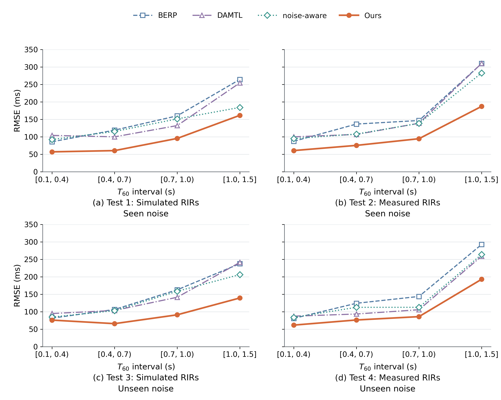

<!-- Generated from frozen main_zh.md; source sha256: 7a8fce1bfaae5a111faffb880249d182992034e0da07729272aa76dbd180c3ed -->

> 对照说明：中文保留冻结主稿原文；每个单元附对应英文。公式与图件共享。以下编辑状态备注为源稿历史工作备注，不属于投稿正文；本轮英文与双语输出已完成同步。

<!-- BEGIN U001 source-lines 1-1 -->

**中文原文**

# DACT-KAN：基于时频 Conformer 的去噪辅助盲混响时间估计

**English**

# DACT-KAN: Denoising-Aided Blind Reverberation Time Estimation Based on a Time–Frequency Conformer

<!-- END U001 -->

<!-- BEGIN U002 source-lines 3-3 -->

**中文原文**

**作者：** 谢欣妮、陆锡堃、桑晋秋（华东师范大学）

**English**

**Authors:** Xinni Xie, Xikun Lu, and Jinqiu Sang (East China Normal University)

<!-- END U002 -->

<!-- BEGIN U003 source-lines 5-6 -->

**源稿编辑备注（不进入投稿正文）**

> **本文档为中文精修主稿。** 当前按“中文定稿后再生成英文”的流程修订；英文 `docs/main.tex` 与旧版 `docs/main_bilingual.md` 暂未同步本轮修改。
> 主模型及表 5 的三组消融采用 seed=42 的训练结果；MLP 对照采用参数量匹配、dropout=0.1 的配置。表 3 保留单任务 KAN 基线（RMSE 111.45 ms）；表 4 和表 6 的主模型结果已统一。

<!-- END U003 -->

<!-- BEGIN U004 source-lines 8-8 -->

---

<!-- END U004 -->

<!-- BEGIN U005 source-lines 10-10 -->

**中文原文**

## 摘要

**English**

## Abstract

<!-- END U005 -->

<!-- BEGIN U006 source-lines 12-12 -->

**中文原文**

噪声对晚期混响衰减信息的掩蔽增加了盲混响时间（$T_{60}$）估计的难度。本文提出一种基于共享时频 Conformer 的去噪辅助多任务学习框架 DACT-KAN（Denoising-Aided Conformer for T60 Estimation with a Fourier-KAN Head），以 $T_{60}$ 回归为主任务、无噪混响语音重建为辅助任务，两条分支并行读取共享特征并进行端到端联合训练。回归分支通过多统计量池化聚合时频特征，并采用两层傅里叶基 Kolmogorov–Arnold 网络（Fourier-KAN）预测 $T_{60}$。在涵盖仿真与实测房间脉冲响应、已见与未见噪声的四个测试集上，所提模型的均方根误差（RMSE）和平均绝对误差（MAE）均低于三种对比方法，四集平均值分别为 92.32 ms 和 55.08 ms。消融实验表明，在采用相同多层感知机（MLP）回归头的条件下，去噪辅助多任务模型相比单任务模型的平均 RMSE 降低 10.8%；在多任务设置下，Fourier-KAN 回归头相比参数量接近、dropout 概率相同的 MLP 回归头进一步降低平均 RMSE 5.1%。

**English**

Noise masks information about late reverberation decay, making blind reverberation time ($T_{60}$) estimation more difficult. This paper presents DACT-KAN (Denoising-Aided Conformer for T60 Estimation with a Fourier-KAN Head), a denoising-aided multi-task learning framework based on a shared time–frequency Conformer. The framework uses $T_{60}$ regression as the primary task and reconstruction of noise-free reverberant speech as the auxiliary task. The two branches receive the shared features in parallel and are jointly trained end to end. The regression branch aggregates time–frequency features through multi-statistic pooling and predicts $T_{60}$ using a two-layer Fourier-based Kolmogorov–Arnold network (Fourier-KAN). On four test sets covering simulated and measured room impulse responses and seen and unseen noise, the proposed model achieves lower root mean squared error (RMSE) and mean absolute error (MAE) than the three comparison methods. The corresponding averages across the four test sets are 92.32 ms and 55.08 ms, respectively. Ablation experiments show that, with the same multilayer perceptron (MLP) regression head, denoising-aided multi-task learning reduces the average RMSE by 10.8% relative to single-task learning. In the multi-task setting, the Fourier-KAN regression head achieves a further 5.1% reduction in average RMSE compared with an MLP regression head with a similar number of parameters and the same dropout rate.

<!-- END U006 -->

<!-- BEGIN U007 source-lines 14-14 -->

**中文原文**

**关键词：** 盲混响时间估计；多任务学习；去噪辅助监督；时频 Conformer；Fourier-KAN

**English**

**Keywords:** blind reverberation time estimation; multi-task learning; denoising auxiliary supervision; time–frequency Conformer; Fourier-KAN

<!-- END U007 -->

<!-- BEGIN U008 source-lines 16-16 -->

---

<!-- END U008 -->

<!-- BEGIN U009 source-lines 18-18 -->

**中文原文**

## 1 引言

**English**

## 1 Introduction

<!-- END U009 -->

<!-- BEGIN U010 source-lines 20-20 -->

**中文原文**

当声源在一个封闭空间中发声时，接收端不仅捕获直达声，还会接收到来自周围壁面的大量反射声（Kuttruff 等，2013）。这些反射声随时间衰减，共同构成房间的混响。声源停止后，声能衰减 60 dB 所需的时间被定义为混响时间 $T_{60}$（ISO 3382-2，2008）。作为一个概括房间能量衰减行为的标量，$T_{60}$ 是表征封闭空间声学属性最常用的参数之一，直接影响语音质量、可懂度，以及去混响、语音识别、声源定位、虚拟/增强现实渲染等下游音频应用的性能（Benzeghiba 等，2007；Anthes 等，2016）。标准化测量 $T_{60}$ 的方法包括中断噪声法与积分脉冲响应法（Schroeder，1965），二者均需要全向声源、校准过的传声器与训练有素的操作人员。但这类现场测量既不便携，在大规模或原位测量场景下又成本高昂、实现复杂。因此，*盲*估计方法应运而生：在没有任何专用激励信号或房间几何先验的前提下，直接从录制的语音信号中推断 $T_{60}$（Eaton 等，2016）。

**English**

When a source emits sound in an enclosed space, the receiver captures both the direct sound and numerous reflections from the surrounding surfaces (Kuttruff and Mommertz, 2013). These reflections decay over time and together form room reverberation. Reverberation time, $T_{60}$, is defined as the time required for the sound energy to decay by 60 dB after the source stops emitting sound (ISO 3382-2, 2008). As a scalar summary of room energy decay, $T_{60}$ is one of the most widely used parameters for characterising the acoustic properties of enclosed spaces. It directly affects speech quality and intelligibility, as well as the performance of downstream audio applications, including dereverberation, speech recognition, sound source localisation, and virtual/augmented reality rendering (Benzeghiba et al., 2007; Anthes et al., 2016). Standardised methods for measuring $T_{60}$ include the interrupted-noise method and the integrated impulse response method (Schroeder, 1965). Both require an omnidirectional sound source, calibrated microphones, and trained operators. However, these measurement setups lack portability, and large-scale or in situ measurements are costly and complex to carry out. This has motivated *blind* estimation methods that infer $T_{60}$ directly from recorded speech without dedicated excitation signals or prior knowledge of room geometry (Eaton et al., 2016).

<!-- END U010 -->

<!-- BEGIN U011 source-lines 22-22 -->

**中文原文**

过去二十年间，盲 $T_{60}$ 估计积累了大量工作。传统方法依赖统计信号处理：基于模型的估计器将房间脉冲响应（RIR）的晚期部分建模为阻尼高斯过程（Polack，1988），从能量包络的衰减速率恢复 $T_{60}$；基于特征映射的估计器则从手工设计的声学描述子（如衰减速率的负侧方差、谐波分量的音高强度或谱衰减分布）中推导 $T_{60}$（Ratnam 等，2003；Wen 等，2008；Eaton 等，2013；Falk 等，2010；Löllmann 等，2010）。ACE 挑战赛对这些方法作了系统评测（Eaton 等，2016），同时也暴露出两个反复出现的困难：（i）多数估计器受加性噪声正偏置影响，因为类噪声的混响尾被埋没在噪声之中；（ii）解析衰减模型在非平稳或低信噪比（SNR）场景下十分脆弱。即便是带噪声鲁棒性改进的版本，如谱衰减分布估计器（噪声鲁棒且计算量更低，Eaton 等，2013）或子带分解估计器（Prego 等，2015），仍需要一个相对准确的噪声水平先验估计，而噪声非平稳时这本身就是一个难题。可见，加性噪声对混响尾的掩蔽是盲 $T_{60}$ 估计的核心障碍，如何在含噪条件下稳健地恢复衰减结构，成为后续方法反复面对的问题。

**English**

Blind $T_{60}$ estimation has been extensively studied over the past two decades. Traditional methods rely on statistical signal processing. Model-based estimators represent the late part of the room impulse response (RIR) as a damped Gaussian process (Polack, 1988) and recover $T_{60}$ from the decay rate of its energy envelope. Feature-mapping estimators instead derive $T_{60}$ from handcrafted acoustic descriptors, such as the negative-side variance of decay rates, the pitch strength of harmonic components, or the spectral decay distribution (Ratnam et al., 2003; Wen et al., 2008; Eaton et al., 2013; Falk and Chan, 2010; Löllmann et al., 2010). The ACE Challenge systematically evaluated these methods (Eaton et al., 2016) and exposed two recurring difficulties: (i) most estimators exhibit a positive bias under additive noise because the noise-like reverberation tail is buried in the noise; and (ii) analytical decay models are particularly vulnerable under non-stationary or low signal-to-noise ratio (SNR) conditions. Even variants with improved noise robustness, such as the computationally less demanding spectral decay distribution estimator (Eaton et al., 2013) or the subband decomposition estimator (Prego et al., 2015), still require a reasonably accurate prior estimate of the noise level. Obtaining such an estimate is itself difficult when the noise is non-stationary. Thus, masking of the reverberation tail by additive noise is a central obstacle to blind $T_{60}$ estimation. Recovering the decay structure robustly under noisy conditions remains a recurring challenge in subsequent work.

<!-- END U011 -->

<!-- BEGIN U012 source-lines 24-24 -->

**中文原文**

深度学习随后成为一种数据驱动的替代方案。Gamper 等（2018）将 gammatone ERB 子带对数能量特征输入六层卷积神经网络（CNN），并在 ACE 评测语料上评估其盲混响时间估计性能；Xiong 等（2019）将 $T_{60}$ 与早晚期混响比的联合估计建模为时频特征上的分类问题；Deng 等（2020）引入卷积循环网络以在变长语音上在线估计；Srivastava 等（2021）将该框架推广到多通道输入；Götz 等（2023）用三种卷积循环变体处理动态声学条件下的参数估计；Saini 等（2023）证明 MobileViT 风格的 transformer 可在智能手机上实时运行，而 Duangpummet 等（2022）则从全频带 $T_{60}$ 走向 $T_{60}$、早期衰减时间、清晰度与语音传输指数的联合估计。这些模型虽在网络结构上各异，却大多沿用同一种回归器设计，即在时频特征提取网络之上堆叠若干全连接层，将聚合后的特征映射为标量 $T_{60}$。为提升含噪条件下的鲁棒性，已有工作将去噪与 $T_{60}$ 估计相结合。Zheng 等（2022）提出两阶段 noise-aware 框架，先预训练语音与噪声分离网络，再在第二阶段联合优化分离网络与 $T_{60}$ 估计网络。该估计网络同时利用原始含噪幅度谱及估计的语音、噪声幅度谱。Zhang 等（2024）提出去噪辅助多任务学习方法 DAMTL，通过包含复数卷积与复数 LSTM 的共享特征提取网络，端到端联合学习去噪重建与 $T_{60}$ 回归。

**English**

Deep learning subsequently emerged as a data-driven alternative. Gamper and Tashev (2018) used log-energy features from gammatone ERB subbands as input to a six-layer convolutional neural network (CNN) and evaluated its performance in blind reverberation time estimation on the ACE evaluation corpus. Xiong et al. (2019) formulated joint estimation of $T_{60}$ and the early-to-late reverberation ratio as a classification problem using time–frequency features. Deng et al. (2020) introduced a convolutional recurrent network for online estimation from variable-length speech, and Srivastava et al. (2021) extended this framework to multichannel inputs. Götz et al. (2023) used three convolutional recurrent variants to estimate parameters under dynamic acoustic conditions. Saini and Peissig (2023) demonstrated that a MobileViT-style transformer could run in real time on a smartphone. Duangpummet et al. (2022) extended the scope from full-band $T_{60}$ estimation to the joint estimation of $T_{60}$, early decay time, clarity, and the speech transmission index. Despite their architectural differences, most of these models use the same regressor design: a time–frequency feature extraction network is followed by several fully connected layers that map the aggregated features to a scalar $T_{60}$. To improve robustness in noise, previous studies have combined denoising with $T_{60}$ estimation. Zheng et al. (2022) proposed a two-stage noise-aware framework. A speech and noise separation network is first pretrained and then jointly optimised with the $T_{60}$ estimation network in the second stage. The estimation network uses the original noisy magnitude spectrum together with the estimated magnitude spectra of speech and noise. Zhang et al. (2024) proposed DAMTL, a denoising-aided multi-task learning method for joint end-to-end learning of denoising reconstruction and $T_{60}$ regression. The method uses a shared feature extraction network containing complex-valued convolutions and complex-valued LSTMs.

<!-- END U012 -->

<!-- BEGIN U013 source-lines 26-26 -->

**中文原文**

已有研究表明，去噪辅助学习有助于改善含噪条件下的盲 $T_{60}$ 估计。然而，晚期混响尾能量较弱，容易受到噪声掩蔽，为混响衰减信息的提取带来困难。这要求特征学习过程在抑制噪声干扰的同时，保留与混响衰减相关的时频信息。

**English**

Previous studies indicate that denoising-aided learning can improve blind $T_{60}$ estimation in noise. However, the late reverberation tail has low energy and is readily masked by noise, making it difficult to extract information about reverberation decay. Feature learning therefore needs to preserve time–frequency information associated with reverberation decay while suppressing noise interference.

<!-- END U013 -->

<!-- BEGIN U014 source-lines 28-28 -->

**中文原文**

为此，我们构建一个共享时频 Conformer 特征提取网络的多任务框架 DACT-KAN，使去噪重建分支与 $T_{60}$ 回归分支并行读取共享特征。去噪辅助任务以无噪混响语音为目标，通过逐时频点重建监督参与共享特征的学习；$T_{60}$ 分支则通过多统计量池化聚合共享特征，并采用 Fourier-KAN 回归头完成从聚合特征到标量 $T_{60}$ 的非线性映射。

**English**

To this end, we construct DACT-KAN, a multi-task framework with a shared time–frequency Conformer feature extraction network. Its denoising reconstruction branch and $T_{60}$ regression branch receive the shared features in parallel. The auxiliary denoising task targets noise-free reverberant speech and contributes to shared feature learning through reconstruction supervision at each time–frequency bin. The $T_{60}$ branch aggregates the shared features using multi-statistic pooling and employs a Fourier-KAN regression head to map the aggregated features nonlinearly to a scalar $T_{60}$.

<!-- END U014 -->

<!-- BEGIN U015 source-lines 30-30 -->

**中文原文**

本文的主要贡献总结如下。

**English**

The main contributions of this paper are as follows.

<!-- END U015 -->

<!-- BEGIN U016 source-lines 32-34 -->

**中文原文**

1. 我们构建一个基于共享时频 Conformer 的去噪辅助盲 $T_{60}$ 估计框架，以 $T_{60}$ 回归为主任务、无噪混响语音重建为辅助任务，通过端到端联合训练共同优化共享特征提取网络。
2. 我们构建一个基于两层 Fourier-KAN 的 $T_{60}$ 回归头，将多统计量池化后的共享特征映射为标量 $T_{60}$。实验结果表明，在所考察的多任务设置下，该回归头相比参数量接近、dropout 概率相同的 MLP 回归头取得更低的估计误差。
3. 我们在由仿真/真实 RIR 与已见/未见噪声构成的四个测试集上，与单任务基线及 BERP、DAMTL、noise-aware 等方法进行比较，并结合分 SNR、分 $T_{60}$ 区间的结果及消融实验，评估所提框架在不同测试条件下的估计表现。

**English**

1. We construct a denoising-aided blind $T_{60}$ estimation framework based on a shared time–frequency Conformer, with $T_{60}$ regression as the primary task and reconstruction of noise-free reverberant speech as the auxiliary task. End-to-end joint training optimises the shared feature extraction network using both tasks.
2. We construct a two-layer Fourier-KAN $T_{60}$ regression head that maps the shared features obtained through multi-statistic pooling to a scalar $T_{60}$. Experiments show that, in the multi-task setting examined, this head achieves lower estimation error than an MLP regression head with a similar number of parameters and the same dropout rate.
3. We compare the proposed framework with a single-task baseline and methods including BERP, DAMTL, and noise-aware on four test sets covering simulated and measured RIRs and seen and unseen noise. We evaluate its estimation performance under different test conditions using results grouped by SNR and by $T_{60}$ interval, together with ablation experiments.

<!-- END U016 -->

<!-- BEGIN U017 source-lines 36-36 -->

**中文原文**

本文余下部分组织如下。第 2 节形式化声学信号模型以及 RIR 与 $T_{60}$ 的关系。第 3 节详述所提网络，包括 Conformer 特征提取网络、去噪解码分支、多统计量池化层、Fourier-KAN 回归头以及多任务训练目标。第 4 节介绍数据集、基线与实现细节。第 5 节汇报 $T_{60}$ 估计与去噪的定量结果、消融实验及任务权重敏感性分析。第 6 节总结全文。

**English**

The remainder of this paper is organised as follows. Section 2 formalises the acoustic signal model and the relationship between the RIR and $T_{60}$. Section 3 details the proposed network, including the Conformer feature extraction network, denoising decoder branch, multi-statistic pooling layer, Fourier-KAN regression head, and multi-task training objective. Section 4 describes the datasets, baselines, and implementation details. Section 5 reports quantitative results for $T_{60}$ estimation and denoising, ablation experiments, and task-weight sensitivity analysis. Section 6 concludes the paper.

<!-- END U017 -->

<!-- BEGIN U018 source-lines 38-38 -->

---

<!-- END U018 -->

<!-- BEGIN U019 source-lines 40-40 -->

**中文原文**

## 2 信号模型

**English**

## 2 Signal Model

<!-- END U019 -->

<!-- BEGIN U020 source-lines 42-42 -->

**中文原文**

### 2.1 声学信号模型

**English**

### 2.1 Acoustic Signal Model

<!-- END U020 -->

<!-- BEGIN U021 source-lines 44-44 -->

**中文原文**

设 $s(t)$ 为位置固定的声源发出的无混响语音，$h(t)$ 为从声源位置到传声器的房间脉冲响应（RIR），$n(t)$ 为传声器处捕获的互不相关加性噪声。在时域上，录制的含噪混响信号 $y(t)$ 建模为

**English**

Let $s(t)$ denote the anechoic speech emitted by a sound source at a fixed position, $h(t)$ the room impulse response (RIR) from the source to the microphone, and $n(t)$ the uncorrelated additive noise captured at the microphone. In the time domain, the recorded noisy reverberant signal $y(t)$ is modelled as

<!-- END U021 -->

<!-- BEGIN U022 source-lines 46-48 -->

**公式（中英共享） / Shared equation**

$$
y(t) = s(t)\ast h(t) + n(t), \tag{1}
$$

<!-- END U022 -->

<!-- BEGIN U023 source-lines 50-50 -->

**中文原文**

其中 $\ast$ 表示卷积。记无噪混响语音为 $r(t)=s(t)\ast h(t)$，其短时傅里叶变换（STFT）为 $R(k,l)$。由 STFT 的线性性，观测复频谱满足 $Y(k,l)=R(k,l)+N(k,l)$，其中 $k$、$l$ 分别索引频点与时间帧，$N(k,l)$ 为噪声的复频谱。

**English**

where $\ast$ denotes convolution. Let $r(t)=s(t)\ast h(t)$ denote the noise-free reverberant speech and $R(k,l)$ its short-time Fourier transform (STFT). By the linearity of the STFT, the observed complex spectrum satisfies $Y(k,l)=R(k,l)+N(k,l)$, where $k$ and $l$ index frequency bins and time frames, respectively, and $N(k,l)$ is the complex spectrum of the noise.

<!-- END U023 -->

<!-- BEGIN U024 source-lines 52-52 -->

**中文原文**

盲 $T_{60}$ 估计旨在学习映射 $\mathcal{F}:Y \mapsto \hat{T}_{60}$，推理时仅根据录制信号进行预测，无需已知无混响语音、RIR 或噪声分量。上述 $Y(k,l)$ 为未压缩的观测复频谱；第 3 章中的 $\mathbf Y$ 则表示归一化波形经 STFT 和幅度压缩后得到的复频谱。

**English**

Blind $T_{60}$ estimation aims to learn the mapping $\mathcal{F}:Y \mapsto \hat{T}_{60}$. At inference, predictions are made solely from the recorded signal, without requiring the anechoic speech, the RIR, or the noise component. Here, $Y(k,l)$ is the uncompressed observed complex spectrum. In Section 3, $\mathbf Y$ denotes the complex spectrum obtained by applying magnitude compression to the STFT of the normalised waveform.

<!-- END U024 -->

<!-- BEGIN U025 source-lines 54-54 -->

**中文原文**

### 2.2 混响时间与 Polack 模型

**English**

### 2.2 Reverberation Time and the Polack Model

<!-- END U025 -->

<!-- BEGIN U026 source-lines 56-56 -->

**中文原文**

要从观测信号 $y(t)$ 估计 $T_{60}$，需要理解 $T_{60}$ 与 RIR $h(t)$ 结构之间的关系。在晚期弥散混响的理想单指数衰减假设下，Polack 模型（Polack，1988）将晚期 RIR 描述为零均值阻尼高斯过程。以下以该晚期段的起点为时间原点，沿用 $h(t)$ 表示该段响应：

**English**

Estimating $T_{60}$ from the observed signal $y(t)$ requires an understanding of the relationship between $T_{60}$ and the structure of the RIR $h(t)$. Under the idealised assumption of a single exponential decay in late diffuse reverberation, the Polack model (Polack, 1988) describes the late RIR as a zero-mean damped Gaussian process. In what follows, the start of the late segment is taken as the time origin, and the notation $h(t)$ is retained for the response within that segment:

<!-- END U026 -->

<!-- BEGIN U027 source-lines 58-60 -->

**公式（中英共享） / Shared equation**

$$
h(t) = b(t)\, e^{-\delta t},\qquad t\geq 0, \tag{2}
$$

<!-- END U027 -->

<!-- BEGIN U028 source-lines 62-62 -->

**中文原文**

其中 $b(t)$ 是方差为 $\sigma_b^{2}$ 的零均值平稳白噪声过程，$\delta>0$ 为房间的阻尼常数。由式 (2) 的二阶统计可得均方能量包络的衰减规律

**English**

where $b(t)$ is a zero-mean stationary white-noise process with variance $\sigma_b^{2}$, and $\delta>0$ is the room damping constant. The second-order statistics of the model in Eq. (2) give the following decay law for the mean-square energy envelope:

<!-- END U028 -->

<!-- BEGIN U029 source-lines 64-66 -->

**公式（中英共享） / Shared equation**

$$
\mathbb{E}\{|h(t)|^{2}\} = \sigma_b^{2}\,e^{-2\delta t}, \tag{3}
$$

<!-- END U029 -->

<!-- BEGIN U030 source-lines 68-68 -->

**中文原文**

由能量衰减 60 dB 的定义，即 $10\log_{10} e^{-2\delta T_{60}} = -60$，可解得混响时间的解析表达式

**English**

Using the definition of a 60 dB energy decay, namely $10\log_{10} e^{-2\delta T_{60}} = -60$, we obtain the following analytical expression for reverberation time:

<!-- END U030 -->

<!-- BEGIN U031 source-lines 70-72 -->

**公式（中英共享） / Shared equation**

$$
T_{60} = \frac{3\ln 10}{\delta}. \tag{4}
$$

<!-- END U031 -->

<!-- BEGIN U032 source-lines 74-74 -->

**中文原文**

基于模型的估计器通过对（估计得到的）能量包络取对数后作线性回归来拟合衰减速率 $\delta$。然而当混响语音被噪声污染时，包络不再为纯指数，$\delta$ 的估计会产生严重偏置，通常导致 $T_{60}$ 被高估（Gaubitch 等，2012）。这一局限正是使用数据驱动方法、直接学习从 $Y(k,l)$ 到 $\hat{T}_{60}$ 映射的动机。

**English**

Model-based estimators fit the decay rate $\delta$ through linear regression on the logarithm of the estimated energy envelope. When reverberant speech is contaminated by noise, however, the envelope is no longer purely exponential. The estimate of $\delta$ becomes severely biased, usually leading to an overestimate of $T_{60}$ (Gaubitch et al., 2012). This limitation motivates data-driven methods that directly learn the mapping from $Y(k,l)$ to $\hat{T}_{60}$.

<!-- END U032 -->

<!-- BEGIN U033 source-lines 76-76 -->

---

<!-- END U033 -->

<!-- BEGIN U034 source-lines 78-78 -->

**中文原文**

## 3 所提方法

**English**

## 3 Proposed Method

<!-- END U034 -->

<!-- BEGIN U035 source-lines 80-80 -->

**中文原文**

### 3.1 所提多任务框架

**English**

### 3.1 Proposed Multi-Task Framework

<!-- END U035 -->

<!-- BEGIN U036 source-lines 82-82 -->

**中文原文**

如图 1 所示，本文构建一个以 $T_{60}$ 估计为主任务、去噪重建为辅助任务的多任务框架。含噪混响语音经短时傅里叶变换（STFT）后，由稠密卷积编码器和两个串联的时频 Conformer 块（TSCB）提取共享时频特征。网络在共享特征处划分为去噪分支和 $T_{60}$ 回归分支，两条分支分别完成频谱重建和混响时间估计。

**English**

As shown in Fig. 1, we construct a multi-task framework with $T_{60}$ estimation as the primary task and denoising reconstruction as the auxiliary task. The noisy reverberant speech is first transformed using the STFT. Shared time–frequency features are then extracted by a dense convolutional encoder and two cascaded time–frequency Conformer blocks (TSCBs). The network then splits into a denoising branch and a $T_{60}$ regression branch, which perform spectral reconstruction and reverberation time estimation, respectively.

<!-- END U036 -->

<!-- BEGIN U037 source-lines 84-84 -->

**中文原文**

去噪分支用幅度掩码与复数残差结构（Cao 等，2022），重建频谱并通过逆短时傅里叶变换（iSTFT）得到去噪语音。该任务以无噪混响语音为重建目标，在去除加性噪声的同时保留混响。$T_{60}$ 分支直接读取共享特征，经统计量池化和 Fourier-KAN 回归头得到混响时间估计，不以去噪分支输出的语音作为输入。

**English**

The denoising branch reconstructs the spectrum using magnitude masking and complex residuals (Cao et al., 2022). The reconstructed spectrum is then converted to denoised speech using the inverse STFT (iSTFT). Its reconstruction target is noise-free reverberant speech, so that additive noise is removed while reverberation is retained. The $T_{60}$ branch takes the shared features directly as input and estimates reverberation time through multi-statistic pooling and a Fourier-KAN regression head. The denoised speech output is not an input to this branch.

<!-- END U037 -->

<!-- BEGIN U038 source-lines 86-86 -->

**中文原文**

两个任务在训练时共同更新共享特征提取网络，使其同时接受频谱重建与 $T_{60}$ 回归的监督；各分支的专属参数由对应任务损失优化。图 1 仅展示整体模块和输入输出关系，编码器、TSCB、回归头和去噪解码器的内部结构将在后续章节中介绍。

**English**

During training, both tasks update the shared feature extraction network, providing supervision from spectral reconstruction and $T_{60}$ regression. The parameters specific to each branch are optimised by the corresponding task loss. Figure 1 shows only the overall modules and their input–output relationships; the internal structures of the encoder, TSCBs, regression head, and denoising decoders are described in the following sections.

<!-- END U038 -->

<!-- BEGIN U039 source-lines 88-88 -->

*共享图件；中英文图注见下一对应块。 / Shared image; bilingual caption follows.*

<!-- END U039 -->

<!-- BEGIN U040 source-lines 90-90 -->

**中文原文**

**图 1　所提多任务框架。** 含噪混响语音经 STFT 和共享特征提取网络处理后，分别进入上方的去噪辅助分支与下方的 $T_{60}$ 主任务分支。

**English**

**Figure 1. Proposed multi-task framework.** The noisy reverberant speech is first processed using the STFT and the shared feature extraction network. The resulting features are fed in parallel to the upper auxiliary denoising branch and the lower primary $T_{60}$ estimation branch.

<!-- END U040 -->

<!-- BEGIN U041 source-lines 92-92 -->

**中文原文**

### 3.2 稠密卷积编码器

**English**

### 3.2 Dense Convolutional Encoder

<!-- END U041 -->

<!-- BEGIN U042 source-lines 94-94 -->

**中文原文**

稠密卷积编码器将含噪混响语音转换为后续时频建模所需的特征，是两个任务共享特征提取网络的输入阶段。对长度为 $L$ 的单通道输入波形 $y[n]$，首先进行能量归一化：

**English**

The dense convolutional encoder converts noisy reverberant speech into features for subsequent time–frequency modelling and serves as the input stage of the feature extraction network shared by both tasks. A single-channel input waveform $y[n]$ of length $L$ is first energy-normalised:

<!-- END U042 -->

<!-- BEGIN U043 source-lines 96-100 -->

**公式（中英共享） / Shared equation**

$$
c=\sqrt{\frac{L}{\sum_{n=0}^{L-1}y^2[n]+\varepsilon}},
\qquad
\tilde y[n]=c\,y[n], \tag{5}
$$

<!-- END U043 -->

<!-- BEGIN U044 source-lines 102-102 -->

**中文原文**

其中，$\varepsilon>0$ 为数值稳定项。归一化波形经采用 Hamming 窗的短时傅里叶变换得到复频谱，再对其幅度取固定指数 $\gamma$ 次幂（$0<\gamma<1$），相位保持不变。将所得压缩复谱记为 $\mathbf Y\in\mathbb C^{T\times F}$，其中 $T$ 和 $F$ 分别为时间帧数与频点数。其幅度、实部和虚部沿通道维堆叠，构成编码器的三通道输入：

**English**

where $\varepsilon>0$ is a numerical stabilisation term. The normalised waveform is transformed into a complex spectrum using the STFT with a Hamming window. Its magnitude is then raised to a fixed power $\gamma$ ($0<\gamma<1$), while the phase remains unchanged. Denote the resulting compressed complex spectrum by $\mathbf Y\in\mathbb C^{T\times F}$, where $T$ and $F$ are the numbers of time frames and frequency bins, respectively. Its magnitude, real part, and imaginary part are stacked along the channel dimension to form the three-channel encoder input:

<!-- END U044 -->

<!-- BEGIN U045 source-lines 104-113 -->

**公式（中英共享） / Shared equation**

$$
\mathbf X_{\mathrm{in}}
=
\bigl[
|\mathbf Y|,
\operatorname{Re}(\mathbf Y),
\operatorname{Im}(\mathbf Y)
\bigr]
\in\mathbb R^{3\times T\times F}. \tag{6}
$$

<!-- END U045 -->

<!-- BEGIN U046 source-lines 115-115 -->

**中文原文**

编码器采用通道投影、膨胀稠密编码和频率下采样的结构（Cao 等，2022）。如图 2 上方所示，输入首先经过 $1\times1$ 逐点卷积，由三个通道映射至 $C$ 个特征通道，随后接实例归一化与参数化 ReLU（PReLU）激活。该阶段保持时间与频率维度不变，其输出送入膨胀稠密块。

**English**

The encoder consists of channel projection, dilated dense encoding, and frequency downsampling (Cao et al., 2022). As shown in the upper part of Fig. 2, a $1\times1$ pointwise convolution first maps the three input channels to $C$ feature channels, followed by instance normalisation and a parametric ReLU (PReLU) activation. This stage preserves the time and frequency dimensions, and its output is passed to a dilated dense block.

<!-- END U046 -->

<!-- BEGIN U047 source-lines 117-117 -->

**中文原文**

图 2 下方进一步展开了膨胀稠密块的内部结构。该模块包含四层 $2\times3$ 卷积，卷积核的两个维度分别对应时间轴和频率轴。四层卷积的时间膨胀率依次为 $1,2,4,8$，频率膨胀率均为 $1$，各层通过补零保持时频尺寸，并在卷积后依次施加实例归一化与 PReLU。每层以块输入和此前各层输出的通道拼接为输入，生成 $C$ 通道特征，供后续层继续使用。稠密块对外输出第四层生成的特征，而累积拼接用于块内部的层间连接。

**English**

The lower part of Fig. 2 shows the internal structure of the dilated dense block in more detail. The block contains four $2\times3$ convolutional layers, with the two kernel dimensions corresponding to time and frequency, respectively. The four layers have temporal dilation rates of $1,2,4,8$, respectively, and a frequency dilation rate of $1$. Zero-padding preserves the time–frequency dimensions, and each convolution is followed by instance normalisation and PReLU. Each layer takes as input the channel-wise concatenation of the block input and all preceding layer outputs, and produces a feature map with $C$ channels for use by subsequent layers. The block returns the features produced by its fourth layer. The concatenated features are used for internal connections between layers.

<!-- END U047 -->

<!-- BEGIN U048 source-lines 119-119 -->

**中文原文**

稠密块输出随后经过 $1\times3$ 卷积，其时间步长为 $1$、频率步长为 $2$，仅沿频率轴下采样，之后接实例归一化与 PReLU。由此得到编码器输出

**English**

The block output then passes through a $1\times3$ convolution with a temporal stride of $1$ and a frequency stride of $2$, downsampling only along the frequency axis. Instance normalisation and PReLU follow this convolution. The encoder output is thus

<!-- END U048 -->

<!-- BEGIN U049 source-lines 121-128 -->

**公式（中英共享） / Shared equation**

$$
\mathbf F^{(0)}
=
\operatorname{Encoder}(\mathbf X_{\mathrm{in}})
\in\mathbb R^{C\times T\times F'},
\qquad
F'=\left\lceil\frac F2\right\rceil. \tag{7}
$$

<!-- END U049 -->

<!-- BEGIN U050 source-lines 131-131 -->

*共享图件；中英文图注见下一对应块。 / Shared image; bilingual caption follows.*

<!-- END U050 -->

<!-- BEGIN U051 source-lines 133-133 -->

**中文原文**

**图 2　稠密卷积编码器。** 上方为输入投影、膨胀稠密块与频率下采样的处理流程；下方展示时间膨胀率为 1、2、4、8 的四层卷积。圆圈 C 表示沿通道拼接，稠密块最终返回第四层输出。

**English**

**Figure 2. Dense convolutional encoder.** The upper part shows input projection, the dilated dense block, and frequency downsampling; the lower part shows the four convolutional layers with temporal dilation rates of 1, 2, 4, and 8. A circled C denotes channel-wise concatenation, and the dense block returns the output of the fourth layer.

<!-- END U051 -->

<!-- BEGIN U052 source-lines 136-136 -->

**中文原文**

### 3.3 时频 Conformer 块

**English**

### 3.3 Time–Frequency Conformer Block

<!-- END U052 -->

<!-- BEGIN U053 source-lines 138-138 -->

**中文原文**

编码器输出的特征 $\mathbf F^{(0)}\in\mathbb R^{C\times T\times F'}$ 随后送入 $N=2$ 个串联的时频 Conformer 块（TSCB）。每个 TSCB 由时间 Conformer 和频率 Conformer 依次组成，沿两个轴处理时频特征，并保持输入与输出的维度不变（Cao 等，2022）。

**English**

The encoder output $\mathbf F^{(0)}\in\mathbb R^{C\times T\times F'}$ is then passed through $N=2$ cascaded time–frequency Conformer blocks (TSCBs). Each TSCB applies a temporal Conformer followed by a frequency Conformer to process the time–frequency features along the two axes while preserving the input dimensions (Cao et al., 2022).

<!-- END U053 -->

<!-- BEGIN U054 source-lines 140-140 -->

**中文原文**

如图 3(a) 所示，时间阶段将各频率位置的特征组织为长度为 $T$、特征维度为 $C$ 的序列，由时间 Conformer 处理，再将输出与对应输入逐元素相加。随后，频率阶段在更新后的特征上，按各时间帧重新组织出长度为 $F'$、特征维度为 $C$ 的序列，经频率 Conformer 处理后，同样与对应输入逐元素相加。两个阶段的 Conformer 结构相同、参数独立。频率阶段结束后，特征变换为 $C\times T\times F'$ 的布局，作为当前 TSCB 的输出。

**English**

As shown in Fig. 3(a), the temporal stage arranges the features at each frequency position into a sequence of length $T$ with feature dimension $C$. The temporal Conformer processes this sequence, and its output is added element-wise to the corresponding input. The frequency stage then rearranges the updated features at each time frame into a sequence of length $F'$ with feature dimension $C$. The frequency Conformer processes this sequence, and its output is likewise added element-wise to the corresponding input. The Conformers in the two stages have the same architecture but independent parameters. After the frequency stage, the features are rearranged into a $C\times T\times F'$ layout to form the TSCB output.

<!-- END U054 -->

<!-- BEGIN U055 source-lines 142-142 -->

**中文原文**

图 3(b) 进一步展开了单个 Conformer 的内部结构，四个子模块通过残差连接依次更新序列表示（Gulati 等，2020）。对输入序列 $\mathbf Z$，内部计算表示为

**English**

Figure 3(b) shows the internal structure of a single Conformer in more detail. Its four submodules sequentially update the sequence representation through residual connections (Gulati et al., 2020). For an input sequence $\mathbf Z$, the computation can be written as

<!-- END U055 -->

<!-- BEGIN U056 source-lines 144-157 -->

**公式（中英共享） / Shared equation**

$$
\begin{aligned}
\mathbf Z_1
&=\mathbf Z+\tfrac12\operatorname{FFN}_1(\mathbf Z),\\
\mathbf Z_2
&=\mathbf Z_1+\operatorname{MHSA}(\mathbf Z_1),\\
\mathbf Z_3
&=\mathbf Z_2+\operatorname{Conv}(\mathbf Z_2),\\
\mathbf Z_4
&=\mathbf Z_3+\tfrac12\operatorname{FFN}_2(\mathbf Z_3),\\
\mathcal C(\mathbf Z)
&=\operatorname{LN}_{\mathrm{out}}(\mathbf Z_4).
\end{aligned} \tag{8}
$$

<!-- END U056 -->

<!-- BEGIN U057 source-lines 159-159 -->

**中文原文**

其中，$\mathrm{FFN}_1$、$\mathrm{FFN}_2$ 为两个采用预归一化的逐位置前馈模块（Swish 激活），$\mathrm{MHSA}$ 为带 Shaw 式相对位置编码（Shaw 等，2018）的多头自注意力模块，$\mathrm{Conv}$ 为带门控线性单元与批归一化的深度可分离一维卷积模块。多头自注意力和卷积模块前后各设置一个前馈模块，两个前馈残差分支均采用 $1/2$ 的缩放系数，形成 Macaron 式结构。$\mathrm{MHSA}$ 和 $\mathrm{Conv}$ 同样包含各自入口处的层归一化，$\mathrm{LN}_{\mathrm{out}}$ 表示 Conformer 末端的层归一化。

**English**

Here, $\mathrm{FFN}_1$ and $\mathrm{FFN}_2$ are two pre-normalised position-wise feed-forward modules with Swish activations; $\mathrm{MHSA}$ is a multi-head self-attention module with Shaw-style relative positional encoding (Shaw et al., 2018); and $\mathrm{Conv}$ is a depthwise separable one-dimensional convolution module with a gated linear unit and batch normalisation. The self-attention and convolution modules are placed between the two feed-forward modules. Both feed-forward residual branches use a scaling factor of $1/2$, forming a Macaron-style structure. The $\mathrm{MHSA}$ and $\mathrm{Conv}$ modules also include layer normalisation at their respective inputs, and $\mathrm{LN}_{\mathrm{out}}$ denotes the final layer normalisation of the Conformer.

<!-- END U057 -->

<!-- BEGIN U058 source-lines 161-161 -->

**中文原文**

同一内部结构在时间阶段沿时间轴作用，在频率阶段沿频率轴作用。完成上述内部运算与末端归一化后，Conformer 输出再参与图 3(a) 所示的外部残差相加。

**English**

The same internal structure operates along the time axis in the temporal stage and along the frequency axis in the frequency stage. After these internal operations and the final layer normalisation, the Conformer output is added element-wise to the stage input through the external residual connection shown in Fig. 3(a).

<!-- END U058 -->

<!-- BEGIN U059 source-lines 163-163 -->

**中文原文**

经过两个串联的 TSCB 后，得到共享时频特征 $\mathbf F^{(N)}\in\mathbb R^{C\times T\times F'}$，随后并行输入 $T_{60}$ 回归分支（§3.4）和去噪解码分支（§3.5），分别完成混响时间估计与语音重建。

**English**

The two cascaded TSCBs yield shared time–frequency features $\mathbf F^{(N)}\in\mathbb R^{C\times T\times F'}$. These features are then passed in parallel to the $T_{60}$ regression branch (Section 3.4) and the denoising decoder branch (Section 3.5) for reverberation time estimation and speech reconstruction, respectively.

<!-- END U059 -->

<!-- BEGIN U060 source-lines 165-165 -->

*共享图件；中英文图注见下一对应块。 / Shared image; bilingual caption follows.*

<!-- END U060 -->

<!-- BEGIN U061 source-lines 167-167 -->

**中文原文**

**图 3　时频 Conformer 块（TSCB）。** (a) 时间与频率 Conformer 依次处理共享特征，两个阶段均具有外部残差连接；(b) 单个 Conformer 内部的前馈、自注意力和卷积模块及其残差连接。时间与频率 Conformer 采用相同结构，但参数独立。

**English**

**Figure 3. Time–frequency Conformer block (TSCB).** (a) The temporal and frequency Conformers process the shared features sequentially, with an external residual connection at each stage. (b) The feed-forward, self-attention, and convolution modules within a single Conformer and their residual connections. The temporal and frequency Conformers have the same architecture but independent parameters.

<!-- END U061 -->

<!-- BEGIN U062 source-lines 169-169 -->

**中文原文**

### 3.4 基于 Fourier-KAN 的 $T_{60}$ 回归分支

**English**

### 3.4 Fourier-KAN-Based $T_{60}$ Regression Branch

<!-- END U062 -->

<!-- BEGIN U063 source-lines 171-171 -->

**中文原文**

$T_{60}$ 回归分支将共享主干输出的时频特征映射为每个输入样本对应的混响时间估计，其结构如图 4(a) 所示。设共享特征为 $\mathbf F^{(N)}\in\mathbb R^{C\times T\times F'}$，其中 $C$、$T$ 和 $F'$ 分别表示通道数、时间帧数和频率维长度，以下省略批次维度。为获得样本级特征表示，首先沿时间维取平均：

**English**

The $T_{60}$ regression branch maps the time–frequency features from the shared backbone to a reverberation time estimate for each input sample, as shown in Fig. 4(a). Let the shared features be $\mathbf F^{(N)}\in\mathbb R^{C\times T\times F'}$, where $C$, $T$, and $F'$ denote the number of channels, the number of time frames, and the size of the frequency dimension, respectively. The batch dimension is omitted below. To obtain a sample-level feature representation, the features are first averaged along the time dimension:

<!-- END U063 -->

<!-- BEGIN U064 source-lines 173-177 -->

**公式（中英共享） / Shared equation**

$$
\overline F_{c,f}
=
\frac{1}{T}\sum_{t=1}^{T}F^{(N)}_{c,t,f}, \tag{9}
$$

<!-- END U064 -->

<!-- BEGIN U065 source-lines 179-179 -->

**中文原文**

得到 $\overline{\mathbf F}\in\mathbb R^{C\times F'}$。随后，在各通道内沿频率维计算均值、最大值和标准差，并将三类统计量拼接为固定维度向量：

**English**

This yields $\overline{\mathbf F}\in\mathbb R^{C\times F'}$. The mean, maximum, and standard deviation are then computed along the frequency dimension within each channel and concatenated into a fixed-dimensional vector:

<!-- END U065 -->

<!-- BEGIN U066 source-lines 181-191 -->

**公式（中英共享） / Shared equation**

$$
\mathbf z
=
\operatorname{Concat}
\left[
\operatorname{Mean}_{f}(\overline{\mathbf F}),
\operatorname{Max}_{f}(\overline{\mathbf F}),
\operatorname{Std}_{f}(\overline{\mathbf F})
\right]
\in\mathbb R^{3C}. \tag{10}
$$

<!-- END U066 -->

<!-- BEGIN U067 source-lines 193-193 -->

**中文原文**

该向量经线性投影与层归一化后，作为 Fourier-KAN 的输入：

**English**

The vector is passed through a linear projection followed by layer normalisation to form the input to Fourier-KAN:

<!-- END U067 -->

<!-- BEGIN U068 source-lines 195-201 -->

**公式（中英共享） / Shared equation**

$$
\mathbf h^{(0)}
=
\operatorname{LN}_{0}
\left(\mathbf W_{\mathrm p}\mathbf z+\mathbf b_{\mathrm p}\right)
\in\mathbb R^{d_0}, \tag{11}
$$

<!-- END U068 -->

<!-- BEGIN U069 source-lines 203-203 -->

**中文原文**

其中，$\mathbf W_{\mathrm p}$ 和 $\mathbf b_{\mathrm p}$ 为投影层参数，$d_0$ 为投影后的特征维度，$\operatorname{LN}$ 表示层归一化。

**English**

where $\mathbf W_{\mathrm p}$ and $\mathbf b_{\mathrm p}$ are the projection parameters, $d_0$ is the projected feature dimension, and $\operatorname{LN}$ denotes layer normalisation.

<!-- END U069 -->

<!-- BEGIN U070 source-lines 205-205 -->

**中文原文**

KAN 将可学习的一元函数设置在节点之间的连接边上，通过聚合各条边的函数输出构成多维映射（Liu 等，2025）。本文采用傅里叶基参数化这些边函数，构建 Fourier-KAN 回归映射（Li 等，2025）。如图 4(b) 所示，每条连接边对其输入标量进行函数变换，输出节点对所有入边的函数值求和，并加上节点偏置。对于第 $\ell$ 层，其第 $j$ 个节点的聚合结果为

**English**

KAN places learnable univariate functions on the edges connecting nodes and constructs a multidimensional mapping by aggregating the function outputs on these edges (Liu et al., 2025). We use Fourier basis functions to parameterise these edge functions and construct a Fourier-KAN regression mapping (Li et al., 2025). As shown in Fig. 4(b), each edge transforms its scalar input, and each output node sums the function values from all incoming edges and adds a node bias. For layer $\ell$, the aggregated value at node $j$ is

<!-- END U070 -->

<!-- BEGIN U071 source-lines 207-216 -->

**公式（中英共享） / Shared equation**

$$
u_j^{(\ell)}
=
\sum_{i=1}^{d_{\ell-1}}
\phi_{ji}^{(\ell)}
\left(h_i^{(\ell-1)}\right)
+
b_j^{(\ell)},
\qquad j=1,\ldots,d_\ell, \tag{12}
$$

<!-- END U071 -->

<!-- BEGIN U072 source-lines 218-218 -->

**中文原文**

其中，$d_{\ell-1}$ 和 $d_\ell$ 分别为该层的输入维度与输出维度，$\phi_{ji}^{(\ell)}$ 表示从输入节点 $i$ 到输出节点 $j$ 的边函数，$b_j^{(\ell)}$ 为节点偏置。

**English**

where $d_{\ell-1}$ and $d_\ell$ are the input and output dimensions of the layer, respectively, $\phi_{ji}^{(\ell)}$ is the edge function from input node $i$ to output node $j$, and $b_j^{(\ell)}$ is the node bias.

<!-- END U072 -->

<!-- BEGIN U073 source-lines 220-220 -->

**中文原文**

图 4(c) 进一步展示了图 4(b) 中高亮边的函数构成。每条边函数均由有限个正弦、余弦基函数加权组合：

**English**

Figure 4(c) shows how the function on the highlighted edge in Fig. 4(b) is constructed. Each edge function is a weighted combination of a finite number of sine and cosine basis functions:

<!-- END U073 -->

<!-- BEGIN U074 source-lines 222-231 -->

**公式（中英共享） / Shared equation**

$$
\phi_{ji}^{(\ell)}(x)
=
\sum_{k=1}^{K_\ell}
\left[
a_{jik}^{(\ell)}\cos(kx)
+
c_{jik}^{(\ell)}\sin(kx)
\right], \tag{13}
$$

<!-- END U074 -->

<!-- BEGIN U075 source-lines 233-233 -->

**中文原文**

其中，$x$ 为该边接收的标量特征，$K_\ell$ 为第 $\ell$ 层的展开阶数，$k=1,\ldots,K_\ell$ 为固定整数阶次；$a_{jik}^{(\ell)}$ 和 $c_{jik}^{(\ell)}$ 分别为余弦项与正弦项的可学习系数。因此，边函数的形状由各基函数的组合系数决定，并随训练过程中系数的更新而调整。

**English**

Here, $x$ is the scalar input to the edge function, and $K_\ell$ is the Fourier expansion order of layer $\ell$. The index $k$ takes the fixed integer values $1,\ldots,K_\ell$. The learnable coefficients $a_{jik}^{(\ell)}$ and $c_{jik}^{(\ell)}$ weight the cosine and sine terms, respectively. The shape of the edge function is therefore determined by these basis coefficients and changes as the coefficients are updated during training.

<!-- END U075 -->

<!-- BEGIN U076 source-lines 235-235 -->

**中文原文**

回归分支串联两层 Fourier-KAN，每层在完成边函数变换与节点聚合后，依次施加层归一化和 Dropout：

**English**

The regression branch cascades two Fourier-KAN layers. After edge-function transformations and node aggregation, each layer applies layer normalisation followed by dropout:

<!-- END U076 -->

<!-- BEGIN U077 source-lines 237-246 -->

**公式（中英共享） / Shared equation**

$$
\mathbf h^{(\ell)}
=
\operatorname{Dropout}_{\ell}
\left(
\operatorname{LN}_{\ell}
\left(\mathbf u^{(\ell)}\right)
\right),
\qquad \ell=1,2. \tag{14}
$$

<!-- END U077 -->

<!-- BEGIN U078 source-lines 248-248 -->

**中文原文**

第二层输出 $\mathbf h^{(2)}\in\mathbb R^{d_2}$ 经线性映射和 Sigmoid 函数，得到归一化的 $T_{60}$ 预测值：

**English**

The second-layer output $\mathbf h^{(2)}\in\mathbb R^{d_2}$ is passed through a linear mapping and a sigmoid function to obtain the normalised $T_{60}$ prediction:

<!-- END U078 -->

<!-- BEGIN U079 source-lines 250-259 -->

**公式（中英共享） / Shared equation**

$$
\hat{T}_{60}^{\mathrm{norm}}
=
\sigma\left(
\mathbf w_{\mathrm o}^{\mathsf T}\mathbf h^{(2)}
+
b_{\mathrm o}
\right)
\in(0,1), \tag{15}
$$

<!-- END U079 -->

<!-- BEGIN U080 source-lines 261-261 -->

**中文原文**

其中，$\mathbf w_{\mathrm o}$ 和 $b_{\mathrm o}$ 为输出层参数，$\sigma(\cdot)$ 表示 Sigmoid 函数。

**English**

where $\mathbf w_{\mathrm o}$ and $b_{\mathrm o}$ are the output-layer parameters, and $\sigma(\cdot)$ denotes the sigmoid function.

<!-- END U080 -->

<!-- BEGIN U081 source-lines 263-263 -->

*共享图件；中英文图注见下一对应块。 / Shared image; bilingual caption follows.*

<!-- END U081 -->

<!-- BEGIN U082 source-lines 265-265 -->

**中文原文**

**图 4　$T_{60}$ 回归分支及 Fourier-KAN 边函数。** (a) 回归分支总体流程；(b) Fourier-KAN 映射示意图；(c) 单条边函数的傅里叶展开示意图。

**English**

**Figure 4. $T_{60}$ regression branch and Fourier-KAN edge functions.** (a) Overall workflow of the regression branch. (b) Schematic of the Fourier-KAN mapping. (c) Schematic of the Fourier expansion of a single edge function.

<!-- END U082 -->

<!-- BEGIN U083 source-lines 267-267 -->

**中文原文**

### 3.5 去噪解码分支

**English**

### 3.5 Denoising Decoder Branch

<!-- END U083 -->

<!-- BEGIN U084 source-lines 269-269 -->

**中文原文**

去噪解码分支接收共享时频特征 $\mathbf F^{(N)}$，以无噪混响语音 $\tilde s(t)=s(t)\ast h(t)$ 为重建目标，为共享特征提取网络提供辅助监督。目标波形与含噪输入共用由输入计算的能量归一化系数（见式 (5)），并采用 §3.2 中相同的短时傅里叶变换与功率压缩处理。以下将输入压缩复谱记为 $\mathbf Y$，目标压缩复谱记为 $\tilde S$。

**English**

The denoising decoder branch receives the shared time–frequency features $\mathbf F^{(N)}$ and uses noise-free reverberant speech $\tilde s(t)=s(t)\ast h(t)$ as the reconstruction target, providing auxiliary supervision for the shared feature extraction network. The target waveform and noisy input share the energy normalisation coefficient computed from the input (Eq. (5)) and undergo the same STFT and power-law compression described in Section 3.2. Below, $\mathbf Y$ denotes the compressed complex input spectrum, and $\tilde S$ denotes the compressed complex target spectrum.

<!-- END U084 -->

<!-- BEGIN U085 source-lines 271-271 -->

**中文原文**

该分支采用幅度掩码与复数残差的并行解码结构（Cao 等，2022）。如图 5 所示，两条路径分别通过参数独立的膨胀稠密块处理共享特征，再结合频率方向的子像素上采样与卷积映射，将频率维度由 $F'$ 恢复至 $F$，同时保持时间帧数 $T$ 不变。上方的掩码路径输出单通道实值掩码 $M$，其末端采用逐频率参数化的 PReLU 激活；下方的复数路径输出双通道残差 $\Delta$，两个通道分别对应实部与虚部，输出层不施加激活函数。两条路径的映射表示为

**English**

This branch uses parallel magnitude-mask and complex-residual decoding paths (Cao et al., 2022). As shown in Fig. 5, the two paths process the shared features using dilated dense blocks with independent parameters. Frequency-axis sub-pixel upsampling and convolutional mappings then restore the frequency dimension from $F'$ to $F$ while preserving the number of time frames $T$. The upper mask path outputs a single-channel real-valued mask $M$ and ends with a PReLU activation parameterised separately for each frequency. The lower complex path outputs a two-channel residual $\Delta$, whose channels correspond to the real and imaginary parts; no activation is applied at its output layer. The two mappings are expressed as

<!-- END U085 -->

<!-- BEGIN U086 source-lines 273-282 -->

**公式（中英共享） / Shared equation**

$$
M=\mathcal D_{\mathrm{mask}}\!\left(\mathbf F^{(N)}\right),
\qquad
\Delta=\mathcal D_{\mathrm{complex}}\!\left(\mathbf F^{(N)}\right)
=
\begin{bmatrix}
\Delta_{\mathrm{re}}\\
\Delta_{\mathrm{im}}
\end{bmatrix}, \tag{16}
$$

<!-- END U086 -->

<!-- BEGIN U087 source-lines 284-284 -->

**中文原文**

其中，$\mathcal D_{\mathrm{mask}}$ 和 $\mathcal D_{\mathrm{complex}}$ 分别表示掩码解码器与复数残差解码器。

**English**

where $\mathcal D_{\mathrm{mask}}$ and $\mathcal D_{\mathrm{complex}}$ denote the mask decoder and complex-residual decoder, respectively.

<!-- END U087 -->

<!-- BEGIN U088 source-lines 286-286 -->

**中文原文**

图 5 右侧展示了两条路径输出的组合方式。掩码首先与输入压缩幅度逐元素相乘，得到掩码调整后的幅度分量 $\hat A=M\odot|\mathbf Y|$，再结合输入相位构成初始复谱。复数路径输出的残差分别叠加到该复谱的实部与虚部，得到

**English**

The right-hand side of Fig. 5 shows how the two path outputs are combined. The mask is first multiplied element-wise by the compressed input magnitude to obtain the masked magnitude $\hat A=M\odot|\mathbf Y|$. This magnitude is then combined with the input phase to form an initial complex spectrum. The residuals from the complex path are then added to the real and imaginary parts of this spectrum, respectively:

<!-- END U088 -->

<!-- BEGIN U089 source-lines 288-299 -->

**公式（中英共享） / Shared equation**

$$
\begin{aligned}
\hat Y_{\mathrm{re}}
&=
\hat A\odot\cos\!\left(\angle\mathbf Y\right)
+\Delta_{\mathrm{re}},\\
\hat Y_{\mathrm{im}}
&=
\hat A\odot\sin\!\left(\angle\mathbf Y\right)
+\Delta_{\mathrm{im}},
\end{aligned} \tag{17}
$$

<!-- END U089 -->

<!-- BEGIN U090 source-lines 301-301 -->

**中文原文**

其中，$\odot$ 表示逐元素乘法，$\angle\mathbf Y$ 为输入相位。由此得到预测压缩复谱 $\hat{\mathbf Y}=\hat Y_{\mathrm{re}}+j\hat Y_{\mathrm{im}}$：掩码路径对输入幅度分量进行调整，复数残差路径进一步修正重组后的实部与虚部。

**English**

Here, $\odot$ denotes element-wise multiplication, and $\angle\mathbf Y$ is the input phase. This gives the predicted compressed complex spectrum $\hat{\mathbf Y}=\hat Y_{\mathrm{re}}+j\hat Y_{\mathrm{im}}$: the mask path adjusts the input magnitude component, while the complex-residual path further corrects the reconstructed real and imaginary parts.

<!-- END U090 -->

<!-- BEGIN U091 source-lines 303-303 -->

**中文原文**

上述乘法与残差相加均在功率压缩后的复谱域进行。对 $\hat{\mathbf Y}$ 的幅度进行功率反压缩，再经逆短时傅里叶变换得到去噪波形 $\hat s(t)$。预测复谱及波形与相应目标之间的重建误差，通过 §3.6 定义的联合损失参与网络优化。

**English**

Both the multiplication and residual addition are performed in the power-compressed complex spectral domain. The power-law compression of the magnitude of $\hat{\mathbf Y}$ is first inverted. The iSTFT is then applied to obtain the denoised waveform $\hat s(t)$. Reconstruction errors for the predicted spectrum and waveform, each relative to its corresponding target, contribute to network optimisation through the joint loss defined in Section 3.6.

<!-- END U091 -->

<!-- BEGIN U092 source-lines 305-305 -->

*共享图件；中英文图注见下一对应块。 / Shared image; bilingual caption follows.*

<!-- END U092 -->

<!-- BEGIN U093 source-lines 307-307 -->

**中文原文**

**图 5　去噪解码分支。** 共享 TSCB 特征分别输入幅度掩码解码器与复数残差解码器。掩码与含噪幅度逐元素相乘，结合含噪相位重组成初始复谱，再与复数残差逐元素相加。图中乘法和加法节点分别表示这两种运算；复数残差的两个通道对应实部与虚部。图示运算位于功率压缩域，反压缩与 iSTFT 位于重建复谱之后。

**English**

**Figure 5. Denoising decoder branch.** Shared TSCB features are passed to the magnitude-mask and complex-residual decoders. The mask is multiplied element-wise by the noisy magnitude, and the resulting magnitude is combined with the noisy phase to reconstruct an initial complex spectrum. The complex residual is then added element-wise to this spectrum. The multiplication and addition nodes represent these two operations, respectively; the two channels of the complex residual correspond to its real and imaginary parts. The illustrated operations take place in the power-compressed domain, with inverse compression and the iSTFT applied after complex spectrum reconstruction.

<!-- END U093 -->

<!-- BEGIN U094 source-lines 310-310 -->

**中文原文**

### 3.6 损失函数

**English**

### 3.6 Loss Functions

<!-- END U094 -->

<!-- BEGIN U095 source-lines 312-312 -->

**中文原文**

为匹配式 (15) 中 sigmoid 的输出范围，每个真值 $T_{60}$ 在送入损失前线性映射到 $[0,1]$：

**English**

To match the sigmoid output range in Eq. (15), each ground-truth $T_{60}$ is linearly mapped to $[0,1]$ before the loss is computed:

<!-- END U095 -->

<!-- BEGIN U096 source-lines 314-316 -->

**公式（中英共享） / Shared equation**

$$
T_{60}^{\mathrm{norm}} = \frac{T_{60} - T_{\min}}{T_{\max} - T_{\min}}. \tag{18}
$$

<!-- END U096 -->

<!-- BEGIN U097 source-lines 318-318 -->

**中文原文**

$T_{60}$ 回归损失为 $B$ 条语音小批量上预测与真值归一化 $T_{60}$ 之间的均方误差：

**English**

The $T_{60}$ regression loss is the mean square error between the predicted and ground-truth normalised $T_{60}$ values over a mini-batch of $B$ utterances:

<!-- END U097 -->

<!-- BEGIN U098 source-lines 320-322 -->

**公式（中英共享） / Shared equation**

$$
\mathcal{L}_{T_{60}}(\boldsymbol{\theta}) = \frac{1}{B}\sum_{i=1}^{B}\bigl(\hat{T}_{60,i}^{\mathrm{norm}} - T_{60,i}^{\mathrm{norm}}\bigr)^{2}. \tag{19}
$$

<!-- END U098 -->

<!-- BEGIN U099 source-lines 324-324 -->

**中文原文**

去噪损失结合压缩域实/虚部损失、幅度损失与时域损失：

**English**

The denoising loss combines real/imaginary-part and magnitude losses in the compressed domain with a time-domain loss:

<!-- END U099 -->

<!-- BEGIN U100 source-lines 326-328 -->

**公式（中英共享） / Shared equation**

$$
\mathcal{L}_{\text{den}} = w_{ri}\,\mathcal{L}_{ri} + w_{mag}\,\mathcal{L}_{mag} + w_{time}\,\mathcal{L}_{time}, \tag{20}
$$

<!-- END U100 -->

<!-- BEGIN U101 source-lines 330-330 -->

**中文原文**

其中，$\mathcal{L}_{ri}$ 为预测压缩复谱与目标 $\tilde{S}$ 的实部均方误差与虚部均方误差之和，$\mathcal{L}_{mag}$ 为二者幅度的均方误差；$\mathcal{L}_{time}$ 为反压缩及 iSTFT 后的增强波形 $\hat s$ 与归一化目标 $c\,\tilde s$ 之间的平均绝对误差；$\tilde s=s\ast h$ 为无噪混响语音，每条语音的目标与含噪输入共用式 (5) 的归一化系数 $c$；目标压缩复谱 $\tilde{S}$ 由该归一化目标经相同的 STFT 与功率压缩得到。

**English**

Here, $\mathcal{L}_{ri}$ is the sum of the real-part and imaginary-part mean square errors between the predicted compressed complex spectrum and the target $\tilde{S}$, and $\mathcal{L}_{mag}$ is the mean square error between their magnitudes. The time-domain loss $\mathcal{L}_{time}$ is the mean absolute error between the enhanced waveform $\hat s$ and the normalised target $c\,\tilde s$, with $\hat s$ obtained after inverse compression and the iSTFT. The noise-free reverberant speech is $\tilde s=s\ast h$; for each utterance, the target and noisy input share the normalisation coefficient $c$ in Eq. (5). The compressed complex target spectrum $\tilde{S}$ is obtained by applying the same STFT and power-law compression to this normalised target.

<!-- END U101 -->

<!-- BEGIN U102 source-lines 332-332 -->

**中文原文**

为缓解去噪损失与 $T_{60}$ 损失的数值量级差异，分别以各自的指数移动平均（EMA）进行缩放。令 $q\in\{\mathrm{den},T_{60}\}$ 表示任务，$u$ 表示损失函数的小批量调用序号，则

**English**

To reduce the difference in numerical scale between the denoising and $T_{60}$ losses, each loss is scaled using its own exponential moving average (EMA). Let $q\in\{\mathrm{den},T_{60}\}$ denote the task and $u$ index mini-batch calls to the loss function. Then,

<!-- END U102 -->

<!-- BEGIN U103 source-lines 334-340 -->

**公式（中英共享） / Shared equation**

$$
\begin{aligned}
m_{q,1}&=\operatorname{stopgrad}(\mathcal{L}_{q,1}),\\
m_{q,u}&=\rho\,m_{q,u-1}+(1-\rho)\operatorname{stopgrad}(\mathcal{L}_{q,u}),\qquad u>1,\\
\mathcal{L}_{q,u}^{*}&=\frac{\mathcal{L}_{q,u}}{m_{q,u}+\varepsilon_{\mathrm{EMA}}}.
\end{aligned}
$$

<!-- END U103 -->

<!-- BEGIN U104 source-lines 342-342 -->

**中文原文**

其中，$\rho=0.99$，$\varepsilon_{\mathrm{EMA}}=10^{-8}$，$\operatorname{stopgrad}(\cdot)$ 表示停止梯度。首个批次直接以当前损失初始化 EMA；每次调用均先更新 EMA，再以更新后的值进行归一化，分母不参与反向传播。在实现中，训练与验证共用同一组 EMA 状态，均按小批量更新，并在阶段切换与相邻 epoch 间连续保留；验证阶段不进行反向传播或模型参数更新。

**English**

where $\rho=0.99$, $\varepsilon_{\mathrm{EMA}}=10^{-8}$, and $\operatorname{stopgrad}(\cdot)$ denotes the stop-gradient operation. The EMA is initialised directly with the current loss on the first batch. On every call, the EMA is updated before the loss is normalised by the updated value; no gradients are propagated through the denominator. In the implementation, training and validation share the same EMA states, which are updated per mini-batch in both phases and retained continuously across phase transitions and successive epochs. No backpropagation or model parameter updates are performed during validation.

<!-- END U104 -->

<!-- BEGIN U105 source-lines 344-344 -->

**中文原文**

上述缩放用于调整两项损失的数值尺度，总损失为

**English**

This scaling adjusts the numerical scales of the two losses. The total loss is

<!-- END U105 -->

<!-- BEGIN U106 source-lines 346-348 -->

**公式（中英共享） / Shared equation**

$$
\mathcal{L}(\boldsymbol{\theta}) = \alpha\,\mathcal{L}_{\text{den}}^{*}(\boldsymbol{\theta}) + \beta\,\mathcal{L}_{T_{60}}^{*}(\boldsymbol{\theta}), \tag{21}
$$

<!-- END U106 -->

<!-- BEGIN U107 source-lines 350-350 -->

**中文原文**

其中 $\boldsymbol{\theta}$ 收集共享编码器与 TSCB、Fourier-KAN 头及两个去噪解码器的所有可训练参数。损失权重与主模型配置见 §4.3。

**English**

where $\boldsymbol{\theta}$ comprises all trainable parameters of the shared encoder and TSCBs, the Fourier-KAN head, and the two denoising decoders. The loss weights and main model configuration are given in Section 4.3.

<!-- END U107 -->

<!-- BEGIN U108 source-lines 352-352 -->

**中文原文**

推理时将 sigmoid 输出按式 (18) 的逆映射反归一化，得到最终估计 $\hat{T}_{60}\in[T_{\min}, T_{\max}]$。

**English**

At inference, the sigmoid output is denormalised using the inverse of Eq. (18), yielding the final estimate $\hat{T}_{60}\in[T_{\min}, T_{\max}]$.

<!-- END U108 -->

<!-- BEGIN U109 source-lines 354-354 -->

---

<!-- END U109 -->

<!-- BEGIN U110 source-lines 356-356 -->

**中文原文**

## 4 实验

**English**

## 4 Experiments

<!-- END U110 -->

<!-- BEGIN U111 source-lines 358-358 -->

**中文原文**

### 4.1 数据集

**English**

### 4.1 Datasets

<!-- END U111 -->

<!-- BEGIN U112 source-lines 360-360 -->

**中文原文**

训练和验证的干净语音来自 WSJ0-SI84，测试语音来自 TIMIT；训练及已见噪声条件使用 DNS-Challenge 2020 的环境噪声，未见噪声来自 NOISEX-92。仿真 RIR 采用 image-source 法生成；训练和验证使用的实测 RIR 来自 OpenAIR、REVERB Challenge 与 RWCP，由 OpenSLR28 提供，测试使用的实测 RIR 来自 ACE Challenge。

**English**

Clean speech for training and validation is drawn from WSJ0-SI84, and test speech is drawn from TIMIT. Environmental noise from DNS-Challenge 2020 is used for training and seen-noise conditions, while unseen noise is drawn from NOISEX-92. Simulated RIRs are generated using the image-source method. Measured RIRs for training and validation are from OpenAIR, REVERB Challenge, and RWCP, provided through OpenSLR28; measured test RIRs are from the ACE Challenge.

<!-- END U112 -->

<!-- BEGIN U113 source-lines 362-362 -->

**中文原文**

实验数据集由 16 kHz 单声道、约 4 秒的含噪混响语音片段组成，$T_{60}$ 覆盖 $[0.1,1.5]$ s。$T_{60}$ 标签采用 [Antsalo 等（2001）](https://aes.org/publications/elibrary/elibrary-page/?id=9992) 的方法从对应 RIR 计算得到，训练与评价均使用由此得到的标量标签。

**English**

The experimental dataset consists of single-channel noisy reverberant speech segments sampled at 16 kHz and lasting approximately 4 s, with $T_{60}$ spanning $[0.1,1.5]$ s. The $T_{60}$ labels are computed from the corresponding RIRs using the method of Antsalo et al. (2001). The resulting scalar labels are used for both training and evaluation.

<!-- END U113 -->

<!-- BEGIN U114 source-lines 364-364 -->

**中文原文**

数据集包含训练集 $40\,000$ 条、验证集 $5\,136$ 条，以及四个各含 $1\,080$ 条的测试集。训练集的 SNR 覆盖 $-5$ 至 $30$ dB，验证集及测试集覆盖 $-5$ 至 $20$ dB，间隔均为 5 dB。

**English**

The dataset contains $40\,000$ training samples, $5\,136$ validation samples, and four test sets of $1\,080$ samples each. The training SNR ranges from $-5$ to $30$ dB, while the validation and test SNRs range from $-5$ to $20$ dB, all in 5 dB steps.

<!-- END U114 -->

<!-- BEGIN U115 source-lines 366-366 -->

**中文原文**

四个测试集由仿真/真实 RIR 与已见/未见噪声交叉组合，构成 $2\times 2$ 的测试设计，如表 1 所示。其中，“已见/未见”指噪声类型是否在训练集中出现。

**English**

The four test sets form a $2\times 2$ design by crossing simulated and measured RIRs with seen and unseen noise, as shown in Table 1. Here, seen and unseen refer to whether the noise type appears in the training set.

<!-- END U115 -->

<!-- BEGIN U116 source-lines 368-368 -->

**中文原文**

**表 1　测试集设计：仿真/真实 RIR 与已见/未见噪声的组合。**

**English**

**Table 1. Test-set design: combinations of simulated and measured RIRs and seen and unseen noise.**

<!-- END U116 -->

<!-- BEGIN U117 source-lines 370-375 -->

**中文原文**

| 测试集 | RIR | 噪声 |
|---|---|---|
| test1 | 仿真（image-source 法） | 已见 |
| test2 | 真实（实测脉冲响应） | 已见 |
| test3 | 仿真（image-source 法） | 未见 |
| test4 | 真实（实测脉冲响应） | 未见 |

**English**

| Test set | RIR | Noise |
|---|---|---|
| Test 1 | Simulated (image-source method) | Seen |
| Test 2 | Measured (recorded impulse responses) | Seen |
| Test 3 | Simulated (image-source method) | Unseen |
| Test 4 | Measured (recorded impulse responses) | Unseen |

<!-- END U117 -->

<!-- BEGIN U118 source-lines 377-377 -->

**中文原文**

图 6(a) 展示训练集与验证集合并后的 $T_{60}$ 分布；图 6(b) 将四个测试集的样本按仿真与真实 RIR 分组，展示相应的 $T_{60}$ 分布。

**English**

Figure 6(a) shows the $T_{60}$ distribution of the combined training and validation sets. Figure 6(b) shows the $T_{60}$ distributions of the four test sets grouped by simulated and measured RIRs.

<!-- END U118 -->

<!-- BEGIN U119 source-lines 379-379 -->

**中文图示说明：** **图 6(a)**　训练池 $T_{60}$ 分布（train + eval，共 45,136 条）

**English:** Figure 6(a). $T_{60}$ distribution of the training pool (train + eval; 45,136 samples in total)

<!-- END U119 -->

<!-- BEGIN U120 source-lines 381-381 -->

**中文图示说明：** **图 6(b)**　测试集 $T_{60}$ 分布：仿真 RIR（test1 + test3）vs 真实 RIR（test2 + test4），各 2,160 条

**English:** Figure 6(b). Test-set $T_{60}$ distributions: simulated RIRs (test1 + test3) versus measured RIRs (test2 + test4), with 2,160 samples each

<!-- END U120 -->

<!-- BEGIN U121 source-lines 383-383 -->

**中文原文**

### 4.2 对比方法与评估指标

**English**

### 4.2 Comparison Methods and Evaluation Metrics

<!-- END U121 -->

<!-- BEGIN U122 source-lines 385-385 -->

**中文原文**

#### 4.2.1 对比方法

**English**

#### 4.2.1 Comparison Methods

<!-- END U122 -->

<!-- BEGIN U123 source-lines 387-387 -->

**中文原文**

本文选取 BERP、DAMTL 和 noise-aware 三种方法作为对照，在第 4.1 节的四个测试集上比较其 $T_{60}$ 估计性能。各方法保存的测试结果对应相同的样本标识、$T_{60}$ 真值与 SNR 条件。

**English**

We compare the $T_{60}$ estimation performance of the proposed model with that of BERP, DAMTL, and noise-aware on the four test sets described in Section 4.1. The saved test results of all methods correspond to the same sample identifiers, ground-truth $T_{60}$ values, and SNR conditions.

<!-- END U123 -->

<!-- BEGIN U124 source-lines 389-389 -->

**中文原文**

BERP（Wang 等，2025）是一种通用的盲房间参数估计框架，通过结合注意力机制与卷积层的共享编码器提取房间特征，并利用独立的参数预测器估计不同房间参数。本文仅评价其 $T_{60}$ 预测，将其作为从含噪混响语音中学习房间特征并进行参数回归的对照方法。

**English**

BERP (Wang et al., 2025) is a general framework for blind room parameter estimation. It extracts room features using a shared encoder that combines attention mechanisms and convolutional layers and uses separate predictors to estimate different room parameters. Only its $T_{60}$ predictions are evaluated here. We use BERP as a baseline that learns room features from noisy reverberant speech for parameter regression.

<!-- END U124 -->

<!-- BEGIN U125 source-lines 391-391 -->

**中文原文**

DAMTL（Zhang 等，2024）以去噪为辅助任务，通过联合学习去噪重建与 $T_{60}$ 估计提高含噪条件下的估计精度。该方法与本文具有相近的主辅任务设置，是比较去噪辅助多任务框架的直接参照。其归档训练记录采用批大小 16、初始学习率 $5\times10^{-4}$，最多训练 100 个 epoch，并依据验证集 $T_{60}$ 损失选择检查点。

**English**

DAMTL (Zhang et al., 2024) uses denoising as an auxiliary task and jointly learns denoising reconstruction and $T_{60}$ estimation to improve estimation accuracy in noise. Its primary and auxiliary tasks are similar to ours, making it a baseline for direct comparison of denoising-aided multi-task frameworks. The archived training records for this baseline document a batch size of 16, an initial learning rate of $5\times10^{-4}$, a maximum of 100 epochs, and checkpoint selection based on the validation $T_{60}$ loss.

<!-- END U125 -->

<!-- BEGIN U126 source-lines 393-393 -->

**中文原文**

noise-aware 时频掩蔽方法（Zheng 等，2022）采用串行的两阶段处理结构：分离网络先估计无噪混响语音和噪声，估计网络再结合原始含噪幅度谱与两路估计幅度谱预测 $T_{60}$。其训练先预训练分离网络，再联合优化分离网络与估计网络。该方法用于比较串行噪声分离结构与本文共享特征、并行分支结构的表现。

**English**

The noise-aware time–frequency masking method (Zheng et al., 2022) uses a serial two-stage processing architecture. A separation network first estimates the magnitude spectra of noise-free reverberant speech and noise. An estimation network then predicts $T_{60}$ using these two estimates together with the magnitude spectrum of the original noisy speech. The separation network is pretrained first; the separation and estimation networks are then jointly optimised. This method provides a comparison between serial noise separation and our shared-feature, parallel-branch architecture.

<!-- END U126 -->

<!-- BEGIN U127 source-lines 395-395 -->

**中文原文**

单任务 Fourier-KAN 基线保留相同的特征提取网络与回归头，移除去噪分支，仅以归一化 $T_{60}$ 标签的均方误差训练。

**English**

The single-task Fourier-KAN baseline retains the same feature extraction network and regression head but removes the denoising branch. It is trained solely using the mean square error between its predictions and the normalised $T_{60}$ labels.

<!-- END U127 -->

<!-- BEGIN U128 source-lines 397-397 -->

**中文原文**

#### 4.2.2 $T_{60}$ 估计指标

**English**

#### 4.2.2 $T_{60}$ Estimation Metrics

<!-- END U128 -->

<!-- BEGIN U129 source-lines 399-399 -->

**中文原文**

**均方根误差（RMSE）。** RMSE 衡量 $T_{60}$ 估计值与真值之间的总体误差，对较大偏差赋予更高的惩罚，其定义为

**English**

**Root mean squared error (RMSE).** RMSE measures the overall discrepancy between estimated and ground-truth $T_{60}$ values, penalising larger deviations more heavily. It is defined as

<!-- END U129 -->

<!-- BEGIN U130 source-lines 401-403 -->

**公式（中英共享） / Shared equation**

$$
\mathrm{RMSE}=\sqrt{\frac{1}{N}\sum_{i=1}^{N}(\hat{T}_{60,i}-T_{60,i})^{2}}, \tag{22}
$$

<!-- END U130 -->

<!-- BEGIN U131 source-lines 405-405 -->

**中文原文**

其中，$N$ 为样本数，$\hat{T}_{60,i}$ 和 $T_{60,i}$ 分别为第 $i$ 个样本的估计值与真值。

**English**

where $N$ is the number of samples, and $\hat{T}_{60,i}$ and $T_{60,i}$ are the estimated and ground-truth values for sample $i$, respectively.

<!-- END U131 -->

<!-- BEGIN U132 source-lines 407-407 -->

**中文原文**

**平均绝对误差（MAE）。** MAE 表示测试样本上估计值与真值的平均绝对偏差，定义为

**English**

**Mean absolute error (MAE).** MAE is the mean absolute deviation between estimated and ground-truth values over the test samples:

<!-- END U132 -->

<!-- BEGIN U133 source-lines 409-411 -->

**公式（中英共享） / Shared equation**

$$
\mathrm{MAE}=\frac{1}{N}\sum_{i=1}^{N}|\hat{T}_{60,i}-T_{60,i}|, \tag{23}
$$

<!-- END U133 -->

<!-- BEGIN U134 source-lines 413-413 -->

**中文原文**

RMSE 和 MAE 均以毫秒报告，数值越小表示估计误差越小。

**English**

Both RMSE and MAE are reported in milliseconds; lower values indicate smaller estimation errors.

<!-- END U134 -->

<!-- BEGIN U135 source-lines 415-415 -->

**中文原文**

**Pearson 相关系数（PCC）。** PCC 衡量估计值与真值的线性相关程度，作为误差指标的补充。其取值范围为 $[-1,1]$，越接近 1 表示正线性相关程度越高，计算式为

**English**

**Pearson correlation coefficient (PCC).** PCC measures the linear correlation between estimated and ground-truth values and complements the error metrics. It ranges over $[-1,1]$, with values closer to 1 indicating a stronger positive linear correlation. It is calculated as

<!-- END U135 -->

<!-- BEGIN U136 source-lines 417-419 -->

**公式（中英共享） / Shared equation**

$$
r=\frac{\sum_{i=1}^{N}(\hat{T}_{60,i}-\bar{\hat{T}}_{60})(T_{60,i}-\bar{T}_{60})}{\sqrt{\sum_{i=1}^{N}(\hat{T}_{60,i}-\bar{\hat{T}}_{60})^{2}}\sqrt{\sum_{i=1}^{N}(T_{60,i}-\bar{T}_{60})^{2}}}, \tag{24}
$$

<!-- END U136 -->

<!-- BEGIN U137 source-lines 421-421 -->

**中文原文**

其中，$\bar{\hat{T}}_{60}$ 和 $\bar{T}_{60}$ 分别为估计值与真值的样本均值。

**English**

where $\bar{\hat{T}}_{60}$ and $\bar{T}_{60}$ are the sample means of the estimated and ground-truth values, respectively.

<!-- END U137 -->

<!-- BEGIN U138 source-lines 423-423 -->

**中文原文**

**决定系数（$R^{2}$）。** $R^{2}$ 以真实值的样本均值为预测基准，评价模型的拟合表现，越接近 1 表示拟合越好，定义为

**English**

**Coefficient of determination ($R^{2}$).** Using the sample mean of the ground-truth values as the reference predictor, $R^{2}$ evaluates the model's fit. Values closer to 1 indicate a better fit. It is defined as

<!-- END U138 -->

<!-- BEGIN U139 source-lines 425-427 -->

**公式（中英共享） / Shared equation**

$$
R^{2}=1-\frac{\sum_{i=1}^{N}(\hat{T}_{60,i}-T_{60,i})^{2}}{\sum_{i=1}^{N}(T_{60,i}-\bar{T}_{60})^{2}}. \tag{25}
$$

<!-- END U139 -->

<!-- BEGIN U140 source-lines 429-429 -->

**中文原文**

主对比结果在各测试集上分别计算后取算术平均，并进一步按 SNR 和 $T_{60}$ 分组分析 RMSE。

**English**

For the main comparison, metrics are calculated separately on each test set and then averaged arithmetically. RMSE is further analysed by SNR and by $T_{60}$ interval.

<!-- END U140 -->

<!-- BEGIN U141 source-lines 431-431 -->

**中文原文**

#### 4.2.3 去噪质量指标

**English**

#### 4.2.3 Denoising Quality Metrics

<!-- END U141 -->

<!-- BEGIN U142 source-lines 433-433 -->

**中文原文**

采用三项常用客观指标评价去噪语音的质量。宽带 PESQ（ITU-T P.862.2）用于评价感知语音质量，STOI（[Taal 等，2011](https://doi.org/10.1109/TASL.2011.2114881)）用于评价语音可懂度，尺度不变信号失真比 SI-SDR（Le Roux 等，2019）用于评价信号重建保真度，以 dB 为单位。三项指标均为数值越高表示性能越好。

**English**

Three commonly used objective metrics evaluate the quality of the denoised speech. Wideband PESQ (ITU-T P.862.2) (ITU-T, 2007) evaluates perceptual speech quality. STOI (Taal et al., 2011) evaluates speech intelligibility. The scale-invariant signal-to-distortion ratio (SI-SDR) (Le Roux et al., 2019) evaluates signal reconstruction fidelity and is reported in dB. Higher values indicate better performance for all three metrics.

<!-- END U142 -->

<!-- BEGIN U143 source-lines 435-435 -->

**中文原文**

所有指标均以无噪混响语音为参考，分别对含噪输入和去噪输出计算，提升量为输出指标与输入指标之差。

**English**

All metrics use noise-free reverberant speech as the reference and are calculated for both the noisy input and denoised output. For each metric, the improvement is defined as the output value minus the input value.

<!-- END U143 -->

<!-- BEGIN U144 source-lines 437-437 -->

**中文原文**

### 4.3 模型与训练设置

**English**

### 4.3 Model and Training Settings

<!-- END U144 -->

<!-- BEGIN U145 source-lines 439-439 -->

**中文原文**

语音输入采用 16 kHz 单声道、4 s 的片段，每条语音包含 $L=64\,000$ 个样本。STFT 使用 Hamming 窗并采用居中处理，窗长与 FFT 点数均为 400，帧移为 100 个样本；能量归一化的稳定项为 $\varepsilon=10^{-8}$，幅度压缩指数为 $\gamma=0.3$，训练与推理采用相同的归一化与幅度压缩处理。由此得到 $T=641$ 帧、$F=201$ 个频点，编码器输出的频率维长度为 $F'=101$。

**English**

Speech inputs are single-channel, 4 s segments sampled at 16 kHz, with $L=64\,000$ samples per utterance. We compute a centred STFT using a 400-sample Hamming window, a 400-point FFT, and a hop size of 100 samples. The stabilising constant for energy normalisation is $\varepsilon=10^{-8}$, and the magnitude compression exponent is $\gamma=0.3$. The same normalisation and magnitude compression are used for training and inference. This gives $T=641$ frames and $F=201$ frequency bins, with an encoder output frequency dimension of $F'=101$.

<!-- END U145 -->

<!-- BEGIN U146 source-lines 441-441 -->

**中文原文**

所提模型的结构参数汇总于表 2。共享特征提取网络采用两个 TSCB，Fourier-KAN 回归头使用两层映射，基函数阶数依次为 16 和 8。

**English**

Table 2 summarises the structural parameters of the proposed model. The shared feature extraction network uses two TSCBs, and the Fourier-KAN regression head uses two mapping layers with Fourier expansion orders of 16 and 8, respectively.

<!-- END U146 -->

<!-- BEGIN U147 source-lines 443-443 -->

**中文原文**

**表 2　网络结构与正则化配置**

**English**

**Table 2. Network architecture and regularisation settings.**

<!-- END U147 -->

<!-- BEGIN U148 source-lines 445-456 -->

**中文原文**

| 模块 | 配置项 | 取值 |
|---|---|---|
| 共享特征提取网络 | 通道数 $C$；TSCB 数量 | 64；2 |
| 每个 Conformer 块 | 注意力头数；每头维度 | 4；16 |
| 每个 Conformer 块 | 前馈扩展因子；一维卷积核大小 | 4；31 |
| 每个 Conformer 块 | 注意力与前馈模块 dropout 概率 | 0.2 |
| Fourier-KAN 回归头 | 池化维度；投影维度 $d_0$ | 192；64 |
| Fourier-KAN 回归头 | 两层输出维度 $(d_1,d_2)$ | (32,16) |
| Fourier-KAN 回归头 | 基函数阶数 $(K_1,K_2)$ | (16,8) |
| Fourier-KAN 回归头 | 层间 dropout 概率 | 0.1 |
| MLP 回归头（消融） | 输入维度；三层隐层维度 | 192；(192,192,64) |
| MLP 回归头（消融） | 隐层激活；dropout 概率 | ReLU；0.1 |

**English**

| Module | Setting | Value |
|---|---|---|
| Shared feature extraction network | Channels $C$; number of TSCBs | 64; 2 |
| Each Conformer block | Attention heads; dimension per head | 4; 16 |
| Each Conformer block | Feed-forward expansion factor; 1D convolution kernel size | 4; 31 |
| Each Conformer block | Attention and feed-forward dropout rate | 0.2 |
| Fourier-KAN regression head | Pooling dimension; projection dimension $d_0$ | 192; 64 |
| Fourier-KAN regression head | Output dimensions of the two layers $(d_1,d_2)$ | (32,16) |
| Fourier-KAN regression head | Fourier expansion orders $(K_1,K_2)$ | (16,8) |
| Fourier-KAN regression head | Inter-layer dropout rate | 0.1 |
| MLP regression head (ablation) | Input dimension; three hidden-layer dimensions | 192; (192,192,64) |
| MLP regression head (ablation) | Hidden activation; dropout rate | ReLU; 0.1 |

<!-- END U148 -->

<!-- BEGIN U149 source-lines 458-458 -->

**中文原文**

Fourier-KAN 各层的正弦和余弦系数采用零均值高斯初始化，标准差为 $1/\sqrt{d_{\ell-1}K_\ell}$，输出偏置初始化为零。去噪损失子权重为 $(w_{ri},w_{mag},w_{time})=(0.1,0.9,0.2)$，主模型的任务权重为 $(\alpha,\beta)=(1.0,0.05)$。

**English**

The sine and cosine coefficients in each Fourier-KAN layer are initialised from a zero-mean Gaussian distribution with standard deviation $1/\sqrt{d_{\ell-1}K_\ell}$, and the output biases are initialised to zero. The denoising loss component weights are $(w_{ri},w_{mag},w_{time})=(0.1,0.9,0.2)$, and the main model uses task weights $(\alpha,\beta)=(1.0,0.05)$.

<!-- END U149 -->

<!-- BEGIN U150 source-lines 460-460 -->

**中文原文**

主模型的随机种子设为 42，采用 4 张 GPU、全局批大小 16。本文模型及内部消融采用 AdamW 优化器（学习率 $5\times10^{-4}$、权重衰减 $10^{-5}$），梯度裁剪 $5.0$，混合精度训练，最多 100 个 epoch。以验证集归一化 $T_{60}$ 均方误差作为检查点保存和早停的依据；仅当该误差较已保存检查点下降超过 $10^{-4}$ 时更新检查点，连续 15 个 epoch 未满足该条件则停止训练。学习率采用 ReduceLROnPlateau 调度，衰减因子为 0.5。

**English**

The main model is trained with a random seed of 42 on four GPUs, using a global batch size of 16. The proposed model and internal ablations use AdamW with a learning rate of $5\times10^{-4}$ and weight decay of $10^{-5}$. Training uses gradient clipping at $5.0$ and mixed precision, with a maximum of 100 epochs. Checkpoint saving and early stopping are based on the validation mean square error of normalised $T_{60}$. A checkpoint is updated only when this error decreases by more than $10^{-4}$ compared with the error at the saved checkpoint. Training stops after 15 consecutive epochs without an improvement that meets this criterion. The learning rate is scheduled using ReduceLROnPlateau with a decay factor of 0.5.

<!-- END U150 -->

<!-- BEGIN U151 source-lines 462-462 -->

---

<!-- END U151 -->

<!-- BEGIN U152 source-lines 464-464 -->

**中文原文**

## 5 结果与讨论

**English**

## 5 Results and Discussion

<!-- END U152 -->

<!-- BEGIN U153 source-lines 466-466 -->

**中文原文**

### 5.1 与基线的结果对比

**English**

### 5.1 Comparison with Baselines

<!-- END U153 -->

<!-- BEGIN U154 source-lines 468-468 -->

**中文原文**

本文在四个测试集上比较所提模型与 BERP、noise-aware、DAMTL 及单任务 Fourier-KAN 基线的估计性能，各测试集指标及其均值见表 3。

**English**

We compare the estimation performance of the proposed model with that of BERP, noise-aware, DAMTL, and the single-task Fourier-KAN baseline on four test sets. Table 3 reports the metrics for each test set and their averages.

<!-- END U154 -->

<!-- BEGIN U155 source-lines 470-470 -->

**中文原文**

**表 3　四个测试集及其平均结果。RMSE/MAE 单位为 ms；四集均值为各测试集指标的算术平均。各组各指标最优值加粗。**

**English**

**Table 3. Results on the four test sets and their averages. RMSE and MAE are in ms; the four-set averages are arithmetic means of the metrics calculated on each test set. The best value of each metric in each group is in bold.**

<!-- END U155 -->

<!-- BEGIN U156 source-lines 472-498 -->

**中文原文**

| 测试集 | 方法 | RMSE ↓ | MAE ↓ | PCC ↑ | R² ↑ |
|---|---|---:|---:|---:|---:|
| **Test 1 · 仿真／已见** | BERP | 148.22 | 91.70 | 0.9028 | 0.8104 |
|  | DAMTL | 140.08 | 85.95 | 0.9125 | 0.8307 |
|  | noise-aware | 128.80 | 83.87 | 0.9260 | 0.8569 |
|  | 单任务 Fourier-KAN | 108.41 | 66.99 | 0.9484 | 0.8986 |
|  | Ours | **88.79** | **51.78** | **0.9660** | **0.9320** |
| **Test 2 · 真实／已见** | BERP | 158.33 | 95.05 | 0.8909 | 0.7839 |
|  | DAMTL | 154.20 | 94.49 | 0.8934 | 0.7950 |
|  | noise-aware | 145.44 | 86.16 | 0.9046 | 0.8177 |
|  | 单任务 Fourier-KAN | 122.46 | 74.95 | 0.9337 | 0.8707 |
|  | Ours | **96.96** | **58.35** | **0.9593** | **0.9190** |
| **Test 3 · 仿真／未见** | BERP | 137.53 | 86.46 | 0.9176 | 0.8374 |
|  | DAMTL | 136.12 | 85.57 | 0.9179 | 0.8408 |
|  | noise-aware | 129.50 | 80.85 | 0.9255 | 0.8559 |
|  | 单任务 Fourier-KAN | 105.76 | 67.14 | 0.9517 | 0.9039 |
|  | Ours | **88.58** | **54.78** | **0.9669** | **0.9326** |
| **Test 4 · 真实／未见** | BERP | 144.71 | 89.58 | 0.9069 | 0.8169 |
|  | DAMTL | 125.38 | 78.27 | 0.9299 | 0.8625 |
|  | noise-aware | 130.92 | 78.65 | 0.9223 | 0.8501 |
|  | 单任务 Fourier-KAN | 109.16 | 67.57 | 0.9469 | 0.8958 |
|  | Ours | **94.95** | **55.42** | **0.9599** | **0.9212** |
| **四集均值** | BERP | 147.20 | 90.70 | 0.9046 | 0.8122 |
|  | DAMTL | 138.94 | 86.07 | 0.9134 | 0.8323 |
|  | noise-aware | 133.66 | 82.38 | 0.9196 | 0.8451 |
|  | 单任务 Fourier-KAN | 111.45 | 69.16 | 0.9452 | 0.8923 |
|  | Ours | **92.32** | **55.08** | **0.9630** | **0.9262** |

**English**

| Test set | Method | RMSE ↓ | MAE ↓ | PCC ↑ | R² ↑ |
|---|---|---:|---:|---:|---:|
| **Test 1 · Simulated/seen** | BERP | 148.22 | 91.70 | 0.9028 | 0.8104 |
|  | DAMTL | 140.08 | 85.95 | 0.9125 | 0.8307 |
|  | noise-aware | 128.80 | 83.87 | 0.9260 | 0.8569 |
|  | Single-task Fourier-KAN | 108.41 | 66.99 | 0.9484 | 0.8986 |
|  | Ours | **88.79** | **51.78** | **0.9660** | **0.9320** |
| **Test 2 · Measured/seen** | BERP | 158.33 | 95.05 | 0.8909 | 0.7839 |
|  | DAMTL | 154.20 | 94.49 | 0.8934 | 0.7950 |
|  | noise-aware | 145.44 | 86.16 | 0.9046 | 0.8177 |
|  | Single-task Fourier-KAN | 122.46 | 74.95 | 0.9337 | 0.8707 |
|  | Ours | **96.96** | **58.35** | **0.9593** | **0.9190** |
| **Test 3 · Simulated/unseen** | BERP | 137.53 | 86.46 | 0.9176 | 0.8374 |
|  | DAMTL | 136.12 | 85.57 | 0.9179 | 0.8408 |
|  | noise-aware | 129.50 | 80.85 | 0.9255 | 0.8559 |
|  | Single-task Fourier-KAN | 105.76 | 67.14 | 0.9517 | 0.9039 |
|  | Ours | **88.58** | **54.78** | **0.9669** | **0.9326** |
| **Test 4 · Measured/unseen** | BERP | 144.71 | 89.58 | 0.9069 | 0.8169 |
|  | DAMTL | 125.38 | 78.27 | 0.9299 | 0.8625 |
|  | noise-aware | 130.92 | 78.65 | 0.9223 | 0.8501 |
|  | Single-task Fourier-KAN | 109.16 | 67.57 | 0.9469 | 0.8958 |
|  | Ours | **94.95** | **55.42** | **0.9599** | **0.9212** |
| **Four-set average** | BERP | 147.20 | 90.70 | 0.9046 | 0.8122 |
|  | DAMTL | 138.94 | 86.07 | 0.9134 | 0.8323 |
|  | noise-aware | 133.66 | 82.38 | 0.9196 | 0.8451 |
|  | Single-task Fourier-KAN | 111.45 | 69.16 | 0.9452 | 0.8923 |
|  | Ours | **92.32** | **55.08** | **0.9630** | **0.9262** |

<!-- END U156 -->

<!-- BEGIN U157 source-lines 500-500 -->

**中文原文**

所提模型在四个测试集上均取得最低的 RMSE 和 MAE，以及最高的 PCC 和 $R^{2}$。其四集平均 RMSE 为 92.32 ms，相比单任务 Fourier-KAN 基线的 111.45 ms 降低 17.2%。

**English**

The proposed model achieves the lowest RMSE and MAE and the highest PCC and $R^{2}$ on all four test sets. Its average RMSE across the four test sets is 92.32 ms, 17.2% lower than that of the single-task Fourier-KAN baseline (111.45 ms).

<!-- END U157 -->

<!-- BEGIN U158 source-lines 502-502 -->

**中文原文**

### 5.2 信噪比对估计精度的影响

**English**

### 5.2 Effect of SNR on Estimation Accuracy

<!-- END U158 -->

<!-- BEGIN U159 source-lines 504-504 -->

**中文原文**

图 7 比较了各方法在四个测试集、六种 SNR 条件下的估计性能。总体而言，随着 SNR 提高，各方法的 RMSE 呈下降趋势，表明噪声水平是影响 $T_{60}$ 估计精度的重要因素。低 SNR 条件下，各方法的估计误差均较大；在较高 SNR 条件下，误差总体较低。

**English**

Figure 7 compares the estimation performance of the methods under six SNR conditions on the four test sets. Overall, RMSE tends to decrease as SNR increases, indicating that noise level is an important factor affecting $T_{60}$ estimation accuracy. All methods have larger estimation errors at low SNRs, whereas errors are generally lower at higher SNRs.

<!-- END U159 -->

<!-- BEGIN U160 source-lines 506-506 -->

**中文原文**

本文方法在大多数 SNR 条件下取得最低 RMSE，且在低 SNR 下的优势较为突出。在 −5 dB 条件下，相比各测试集中表现最好的对比方法，本文方法的 RMSE 降低约 26.5%–41.3%。随着 SNR 提高，本文方法与部分对比方法的差距缩小，例如在图 7(a) 的 20 dB 条件下，本文方法与 noise-aware 的 RMSE 分别为 78.41 ms 和 78.29 ms，表现接近。这些结果表明，本文模型的优势主要体现在噪声较强的条件下。

**English**

The proposed method achieves the lowest RMSE under most SNR conditions, with a more pronounced advantage at low SNRs. At −5 dB, it reduces RMSE by approximately 26.5%–41.3% relative to the best-performing comparison method on each test set. As SNR increases, the gap between the proposed method and some comparison methods narrows. For example, at 20 dB in Fig. 7(a), the proposed method and noise-aware achieve similar RMSEs of 78.41 ms and 78.29 ms, respectively. These results indicate that the model's advantage is mainly observed at lower SNRs.

<!-- END U160 -->

<!-- BEGIN U161 source-lines 508-508 -->

**中文原文**

如图 7(c)、(d) 所示，在未见噪声条件下，本文方法在各 SNR 条件下均取得最低 RMSE，表明其相对于对比方法的优势能够延续至未见噪声场景。

**English**

As shown in Fig. 7(c) and (d), the proposed method achieves the lowest RMSE at every tested SNR under unseen-noise conditions, indicating that its advantage over the comparison methods extends to unseen-noise scenarios.

<!-- END U161 -->

<!-- BEGIN U162 source-lines 510-510 -->

*共享图件；中英文图注见下一对应块。 / Shared image; bilingual caption follows.*

<!-- END U162 -->

<!-- BEGIN U163 source-lines 512-512 -->

**中文原文**

**图 7　信噪比对估计精度的影响。** (a) Test 1：仿真 RIR、已见噪声；(b) Test 2：真实 RIR、已见噪声；(c) Test 3：仿真 RIR、未见噪声；(d) Test 4：真实 RIR、未见噪声。SNR 分别为 −5、0、5、10、15 和 20 dB，各点为相应测试集内该 SNR 下 180 条样本的 RMSE。

**English**

**Figure 7. Effect of SNR on estimation accuracy.** (a) Test 1: simulated RIRs and seen noise. (b) Test 2: measured RIRs and seen noise. (c) Test 3: simulated RIRs and unseen noise. (d) Test 4: measured RIRs and unseen noise. The SNRs are −5, 0, 5, 10, 15, and 20 dB. Each point is the RMSE over the 180 samples at that SNR in the corresponding test set.

<!-- END U163 -->

<!-- BEGIN U164 source-lines 514-514 -->

**中文原文**

### 5.3 混响时间对估计精度的影响

**English**

### 5.3 Effect of Reverberation Time on Estimation Accuracy

<!-- END U164 -->

<!-- BEGIN U165 source-lines 516-516 -->

**中文原文**

图 8 按真实 $T_{60}$ 将各测试集划分为四个区间，比较不同混响条件下的估计误差。各方法的 RMSE 总体上在长混响区间较高，其中 $T_{60}\in[1.0,1.5]$ s 时，四个测试集中的所有方法均取得各自最高的分组 RMSE。本文方法在 $[0.1,0.4)$ s 区间的 RMSE 为 57.1–76.0 ms，在 $[1.0,1.5]$ s 区间增至 139.4–192.9 ms，表明长混响条件仍是当前模型的主要误差来源之一。

**English**

Figure 8 compares estimation errors under different reverberation conditions. For each test set, samples are grouped into four intervals of ground-truth $T_{60}$. The RMSEs of the methods are generally higher in the long-reverberation intervals. In particular, at $T_{60}\in[1.0,1.5]$ s, every method reaches its highest RMSE across the four intervals on each of the four test sets. The proposed method has an RMSE of 57.1–76.0 ms in the $[0.1,0.4)$ s interval, increasing to 139.4–192.9 ms in the $[1.0,1.5]$ s interval, indicating that long reverberation remains one of the major sources of estimation error for the current model.

<!-- END U165 -->

<!-- BEGIN U166 source-lines 518-518 -->

**中文原文**

本文方法在四个测试集的全部 $T_{60}$ 分组中均取得最低 RMSE，在长混响区间也保持了这一优势。以真实 RIR 条件为例，Test 2 中本文方法的 RMSE 为 187.2 ms，而三种对比方法为 282.9–310.3 ms；Test 4 中本文方法为 192.9 ms，对比方法为 258.9–292.5 ms。这说明本文模型在较长混响时间下仍能降低估计误差，但尚未消除长混响与短混响条件之间的精度差距。

**English**

The proposed method achieves the lowest RMSE in every $T_{60}$ interval on all four test sets, retaining this advantage in the long-reverberation interval. For example, in this interval with measured RIRs, it achieves an RMSE of 187.2 ms on Test 2, compared with 282.9–310.3 ms for the three comparison methods. On Test 4, the corresponding values are 192.9 ms and 258.9–292.5 ms. Thus, the proposed model still reduces estimation error at longer reverberation times, although it does not eliminate the accuracy gap between long- and short-reverberation conditions.

<!-- END U166 -->

<!-- BEGIN U167 source-lines 520-520 -->

**中文原文**

进一步比较 RIR 类型，在 $[1.0,1.5]$ s 区间，本文方法在真实 RIR 测试集上的 RMSE 高于相应噪声条件下的仿真 RIR 测试集：已见噪声下为 187.2 ms 与 161.7 ms，未见噪声下为 192.9 ms 与 139.4 ms。其余三种方法在该区间也呈现相同的差异方向，而在较短混响区间，仿真与真实 RIR 之间没有一致的高低关系。因此，结果所反映的困难主要集中在真实 RIR 的长混响条件，不能简单归结为所有真实 RIR 场景都更难。不同测试集的样本组成并非严格配对，这些比较反映当前测试数据上的性能差异，尚不能单独确定其形成原因。

**English**

Within the $[1.0,1.5]$ s interval, the proposed method has higher RMSE on measured-RIR test sets than on simulated-RIR test sets under the corresponding noise conditions: 187.2 ms versus 161.7 ms for seen noise and 192.9 ms versus 139.4 ms for unseen noise. The other three methods show the same pattern in this interval, whereas no consistent ordering between simulated and measured RIRs is observed in the shorter-reverberation intervals. The difficulty reflected in these results is therefore concentrated in long-reverberation conditions with measured RIRs; it cannot simply be generalised to all measured-RIR scenarios. Samples in the different test sets are not strictly paired. These comparisons describe performance differences on the current test data and cannot, by themselves, establish their causes.

<!-- END U167 -->

<!-- BEGIN U168 source-lines 522-522 -->

*共享图件；中英文图注见下一对应块。 / Shared image; bilingual caption follows.*

<!-- END U168 -->

<!-- BEGIN U169 source-lines 524-524 -->

**中文原文**

**图 8　混响时间对估计精度的影响。** 子图 (a)–(d) 的测试场景与图 7 一致。按真实 $T_{60}$ 分为 $[0.1,0.4)$、$[0.4,0.7)$、$[0.7,1.0)$ 和 $[1.0,1.5]$ s 四个区间，各点为相应测试集内该区间样本的 RMSE。

**English**

**Figure 8. Effect of reverberation time on estimation accuracy.** The test scenarios in panels (a)–(d) are the same as those in Fig. 7. Samples are grouped by ground-truth $T_{60}$ into four intervals: $[0.1,0.4)$, $[0.4,0.7)$, $[0.7,1.0)$, and $[1.0,1.5]$ s. Each point is the RMSE over the samples in that interval in the corresponding test set.

<!-- END U169 -->

<!-- BEGIN U170 source-lines 526-526 -->

**中文原文**

### 5.4 消融实验

**English**

### 5.4 Ablation Experiments

<!-- END U170 -->

<!-- BEGIN U171 source-lines 528-528 -->

**中文原文**

**任务权重敏感性分析。** 为比较不同任务权重配置下的估计性能，表 4 汇总了归一化损失 $\mathcal{L}=\alpha\,\mathcal{L}_{\text{den}}^{*}+\beta\,\mathcal{L}_{T_{60}}^{*}$ 下的七组权重配置。在所考察的配置中，$(\alpha,\beta)=(1.0,0.05)$ 取得最低 RMSE，为 92.32 ms。当 $\alpha=1.0$ 时，将 $\beta$ 进一步减小至 0.02 或 0.01，RMSE 分别为 102.83 ms 和 95.65 ms，均未获得进一步改善。这些结果未呈现随去噪损失相对权重增加而单调改善的趋势。引入去噪辅助任务本身的效果由表 5 的逐步消融进一步检验。

**English**

**Task-weight sensitivity analysis.** Table 4 summarises seven weight configurations for the normalised loss $\mathcal{L}=\alpha\,\mathcal{L}_{\text{den}}^{*}+\beta\,\mathcal{L}_{T_{60}}^{*}$ to compare estimation performance under different task weights. Among the configurations examined, $(\alpha,\beta)=(1.0,0.05)$ achieves the lowest RMSE, at 92.32 ms. With $\alpha=1.0$, further decreasing $\beta$ to 0.02 or 0.01 gives RMSEs of 102.83 ms and 95.65 ms, respectively, with no further improvement. These results do not show a monotonic improvement as the relative weight of the denoising loss increases. The effect of introducing the denoising auxiliary task itself is further examined through the stepwise ablation in Table 5.

<!-- END U171 -->

<!-- BEGIN U172 source-lines 530-530 -->

**中文原文**

**表 4　任务权重敏感性分析（归一化损失；test1–test4 平均）**

**English**

**Table 4. Task-weight sensitivity analysis (normalised losses; average over Tests 1–4).**

<!-- END U172 -->

<!-- BEGIN U173 source-lines 532-540 -->

**中文原文**

| 配置 | $(\alpha,\beta)$ | RMSE (ms) ↓ | MAE (ms) ↓ |
|---|---|---|---|
| 去噪主导 | (1.0, 0.01) | 95.65 | 61.78 |
| 去噪主导 | (1.0, 0.02) | 102.83 | 67.24 |
| 去噪主导 | (1.0, 0.05) | **92.32** | **55.08** |
| 去噪主导 | (1.0, 0.1) | 97.79 | 57.95 |
| 去噪主导 | (1.0, 0.3) | 107.10 | 64.28 |
| 持平 | (1.0, 1.0) | 109.90 | 67.16 |
| $T_{60}$ 主导 | (0.1, 1.0) | 109.54 | 68.15 |

**English**

| Configuration | $(\alpha,\beta)$ | RMSE (ms) ↓ | MAE (ms) ↓ |
|---|---|---|---|
| Denoising-dominant | (1.0, 0.01) | 95.65 | 61.78 |
| Denoising-dominant | (1.0, 0.02) | 102.83 | 67.24 |
| Denoising-dominant | (1.0, 0.05) | **92.32** | **55.08** |
| Denoising-dominant | (1.0, 0.1) | 97.79 | 57.95 |
| Denoising-dominant | (1.0, 0.3) | 107.10 | 64.28 |
| Equal-weight | (1.0, 1.0) | 109.90 | 67.16 |
| $T_{60}$-dominant | (0.1, 1.0) | 109.54 | 68.15 |

<!-- END U173 -->

<!-- BEGIN U174 source-lines 542-542 -->

**中文原文**

**多任务训练与回归头设计消融。** 为分别考察去噪辅助多任务训练和回归头设计的作用，表 5 比较单任务 MLP、多任务 MLP 和多任务 Fourier-KAN 三种配置。各配置采用相同的数据划分、随机种子 42 和全局批大小 16，回归头 dropout 概率均为 0.1。MLP 隐层维度为 (192,192,64)，其回归头参数量与 Fourier-KAN 接近；两组多任务配置均采用任务权重 $(\alpha,\beta)=(1.0,0.05)$。

**English**

**Ablation of multi-task training and regression head design.** To examine the roles of denoising-aided multi-task training and regression head design separately, Table 5 compares three configurations: single-task MLP, multi-task MLP, and multi-task Fourier-KAN. All configurations use the same data splits, random seed 42, and global batch size of 16, with a regression head dropout rate of 0.1. The MLP has hidden-layer dimensions of (192,192,64), giving its regression head a parameter count close to that of Fourier-KAN. Both multi-task configurations use task weights $(\alpha,\beta)=(1.0,0.05)$.

<!-- END U174 -->

<!-- BEGIN U175 source-lines 544-544 -->

**中文原文**

**表 5　多任务训练与回归头设计消融（test1–test4 平均；RMSE/MAE 单位 ms）**

**English**

**Table 5. Ablation of multi-task training and regression head design (average over Tests 1–4; RMSE and MAE in ms).**

<!-- END U175 -->

<!-- BEGIN U176 source-lines 546-550 -->

**中文原文**

| Configuration | 头参数量 | RMSE ↓ | MAE ↓ | PCC ↑ | $R^{2}$ ↑ |
|---|---:|---:|---:|---:|---:|
| T60-only (MLP) | 86,529 | 108.99 | 66.29 | 0.9474 | 0.8972 |
| Denoising-aided (MLP) | 86,529 | 97.24 | 59.54 | 0.9590 | 0.9179 |
| Denoising-aided (Fourier-KAN) | 86,369 | **92.32** | **55.08** | **0.9630** | **0.9262** |

**English**

| Configuration | Head parameters | RMSE ↓ | MAE ↓ | PCC ↑ | $R^{2}$ ↑ |
|---|---:|---:|---:|---:|---:|
| T60-only (MLP) | 86,529 | 108.99 | 66.29 | 0.9474 | 0.8972 |
| Denoising-aided (MLP) | 86,529 | 97.24 | 59.54 | 0.9590 | 0.9179 |
| Denoising-aided (Fourier-KAN) | 86,369 | **92.32** | **55.08** | **0.9630** | **0.9262** |

<!-- END U176 -->

<!-- BEGIN U177 source-lines 552-552 -->

**中文原文**

注：括号内表示回归头类型；T60-only 表示仅进行 $T_{60}$ 估计训练，Denoising-aided 表示加入去噪辅助任务。

**English**

Note: Parentheses indicate the regression head type. T60-only denotes training solely for $T_{60}$ estimation, and Denoising-aided denotes the inclusion of the denoising auxiliary task.

<!-- END U177 -->

<!-- BEGIN U178 source-lines 554-554 -->

**中文原文**

**去噪辅助多任务训练的作用。** 如表 5 所示，在保持 MLP 回归头不变的条件下，引入去噪辅助任务后，平均 RMSE 从 108.99 ms 降至 97.24 ms，降低 10.8%；MAE、PCC 和 $R^{2}$ 也均得到改善。这表明，在所考察的配置下，去噪辅助多任务训练有助于提高 $T_{60}$ 估计精度。

**English**

**Effect of denoising-aided multi-task training.** As shown in Table 5, with the MLP regression head held fixed, adding the denoising auxiliary task reduces average RMSE from 108.99 ms to 97.24 ms, a reduction of 10.8%. MAE, PCC, and $R^{2}$ also improve. This indicates that, under the configuration examined, denoising-aided multi-task training helps improve $T_{60}$ estimation accuracy.

<!-- END U178 -->

<!-- BEGIN U179 source-lines 556-556 -->

**中文原文**

**Fourier-KAN 回归头的作用。** 在相同的多任务设置下，采用 Fourier-KAN 后，平均 RMSE 从匹配 MLP 的 97.24 ms 进一步降至 92.32 ms，降低 5.1%，其余三项指标也均得到改善。该结果支持 Fourier-KAN 回归头在本文多任务框架中的有效性。两种头的参数量接近，但内部结构仍有差异，因此上述结果反映完整回归头设计的比较。

**English**

**Effect of the Fourier-KAN regression head.** Under the same multi-task setting, replacing the MLP regression head with Fourier-KAN further reduces average RMSE from 97.24 ms to 92.32 ms, a reduction of 5.1%, while also improving the other three metrics. This result supports the effectiveness of the Fourier-KAN regression head within our multi-task framework. Although the two heads have similar parameter counts, their internal structures still differ. These results therefore compare the complete regression head designs.

<!-- END U179 -->

<!-- BEGIN U180 source-lines 558-558 -->

**中文原文**

表 5 中的头参数量统计各回归头内的全部可训练参数，不包含共享特征提取网络与去噪解码分支。两种回归头采用相同的特征池化方式与 dropout 概率，但在隐层结构、归一化及 dropout 位置等方面仍有差异，不能将全部性能差异归因于 Fourier 基函数形式。

**English**

The head parameter counts in Table 5 include all trainable parameters within each regression head, excluding the shared feature extraction network and denoising decoder branch. The two heads use the same feature pooling method and dropout rate but differ in hidden-layer structure, normalisation, and dropout placement. The performance difference therefore cannot be attributed solely to the Fourier basis formulation.

<!-- END U180 -->

<!-- BEGIN U181 source-lines 560-560 -->

**中文原文**

### 5.5 去噪结果

**English**

### 5.5 Denoising Results

<!-- END U181 -->

<!-- BEGIN U182 source-lines 562-562 -->

**中文原文**

表 6 报告不同任务权重配置的去噪质量（test1–test4 平均）。按 §3.5 定义的目标，这些指标反映在保留混响前提下的噪声去除。

**English**

Table 6 reports denoising quality for different task-weight configurations, averaged over Tests 1–4. Consistent with the target defined in Section 3.5, these metrics reflect noise removal with reverberation preserved.

<!-- END U182 -->

<!-- BEGIN U183 source-lines 564-564 -->

**中文原文**

**表 6　不同任务权重配置的去噪指标（test1–test4 平均）**

**English**

**Table 6. Denoising metrics for different task-weight configurations (average over Tests 1–4).**

<!-- END U183 -->

<!-- BEGIN U184 source-lines 566-571 -->

**中文原文**

| 配置 | PESQ ↑ | STOI ↑ | SI-SDR (dB) ↑ | ΔSI-SDR |
|---|---|---|---|---|
| 含噪输入 | 2.721 | 0.847 | 15.91 | — |
| $T_{60}$ 主导 | 3.077 | 0.891 | 18.80 | +2.89 |
| 持平 | 3.178 | 0.907 | 19.79 | +3.88 |
| **Ours** | **3.481** | **0.930** | **21.21** | **+5.30** |

**English**

| Configuration | PESQ ↑ | STOI ↑ | SI-SDR (dB) ↑ | ΔSI-SDR |
|---|---|---|---|---|
| Noisy input | 2.721 | 0.847 | 15.91 | — |
| $T_{60}$-dominant | 3.077 | 0.891 | 18.80 | +2.89 |
| Equal-weight | 3.178 | 0.907 | 19.79 | +3.88 |
| **Ours** | **3.481** | **0.930** | **21.21** | **+5.30** |

<!-- END U184 -->

<!-- BEGIN U185 source-lines 573-573 -->

**中文原文**

主模型相比含噪输入获得 +0.76 PESQ、+0.08 STOI 和 +5.30 dB SI-SDR 的提升。在表 6 所列的三种任务权重配置中，主模型取得最高的 PESQ、STOI 和 SI-SDR。结合表 4，该配置在所考察的任务权重设置中也取得最低的 $T_{60}$ 估计误差。

**English**

Relative to the noisy input, the main model improves PESQ by +0.76, STOI by +0.08, and SI-SDR by +5.30 dB. It achieves the highest PESQ, STOI, and SI-SDR among the three task-weight configurations in Table 6. Together with Table 4, these results show that this configuration also achieves the lowest $T_{60}$ estimation error among the task weights examined.

<!-- END U185 -->

<!-- BEGIN U186 source-lines 575-575 -->

---

<!-- END U186 -->

<!-- BEGIN U187 source-lines 577-577 -->

**中文原文**

## 6 结论

**English**

## 6 Conclusion

<!-- END U187 -->

<!-- BEGIN U188 source-lines 579-579 -->

**中文原文**

本文提出一个面向盲 $T_{60}$ 估计的多任务学习框架，以 $T_{60}$ 回归为主任务、去噪重建为辅助任务，共享时频 Conformer 特征提取网络，并采用 Fourier-KAN 回归头进行 $T_{60}$ 估计。在四个测试集上，所提模型取得平均 RMSE 92.32 ms，相比单任务 Fourier-KAN 基线降低 17.2%，并优于 BERP、DAMTL 和 noise-aware 等对比方法。消融实验表明，去噪辅助多任务训练使 MLP 模型的平均 RMSE 降低 10.8%；在此基础上，采用参数量接近、dropout 概率相同的 Fourier-KAN 回归头进一步降低 5.1%。任务权重分析进一步表明，联合训练的性能受到权重设置的影响，在所考察的配置中，$(\alpha,\beta)=(1.0,0.05)$ 表现最好。

**English**

This paper presents a multi-task learning framework for blind $T_{60}$ estimation, with $T_{60}$ regression as the primary task and denoising reconstruction as the auxiliary task. The tasks share a time–frequency Conformer feature extraction network, and a Fourier-KAN regression head estimates $T_{60}$. Across the four test sets, the proposed model achieves an average RMSE of 92.32 ms, 17.2% lower than that of the single-task Fourier-KAN baseline. It also outperforms comparison methods including BERP, DAMTL, and noise-aware. Ablation experiments show that denoising-aided multi-task training reduces the MLP model's average RMSE by 10.8% relative to single-task training. Under this multi-task setting, replacing the MLP regression head with a Fourier-KAN head that has a similar parameter count and the same dropout rate further reduces average RMSE by 5.1%. Task-weight analysis further shows that joint training performance depends on the weight settings, with $(\alpha,\beta)=(1.0,0.05)$ performing best among the configurations examined.

<!-- END U188 -->

<!-- BEGIN U189 source-lines 581-581 -->

**中文原文**

本文仍有若干可拓展之处。其一，在当前测试数据的长混响区间（$T_{60}\in[1.0,1.5]$ s），各方法的估计误差普遍高于短混响区间。所提模型虽降低了该区间的误差，精度仍有提升空间；未来可考察针对性数据增强或样本重加权对长混响估计性能的影响。其二，本文聚焦单通道输入，后续可将该多任务框架推广至多通道场景，或与早期衰减时间、清晰度等其他房间声学参数的联合估计相结合。

**English**

Several extensions remain to be explored. First, in the long-reverberation interval of the current test data ($T_{60}\in[1.0,1.5]$ s), the estimation errors of the methods are generally higher than in the short-reverberation intervals. Although the proposed model reduces errors in this interval, there is still scope to improve accuracy. Future work could examine the effects of targeted data augmentation or sample reweighting on estimation performance under long-reverberation conditions. Second, this work focuses on single-channel inputs. The multi-task framework could be extended to multichannel scenarios or adapted for joint estimation of $T_{60}$ and other room acoustic parameters, such as early decay time and clarity.

<!-- END U189 -->
