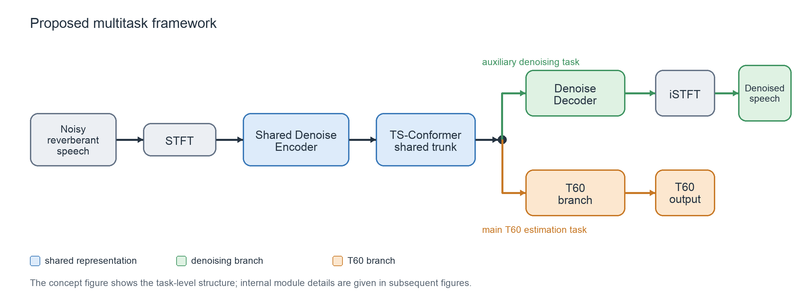
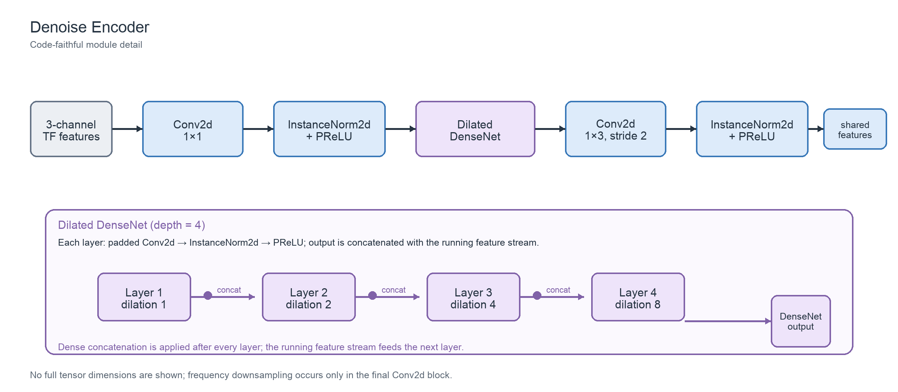
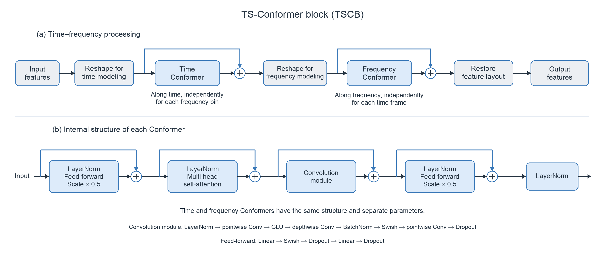
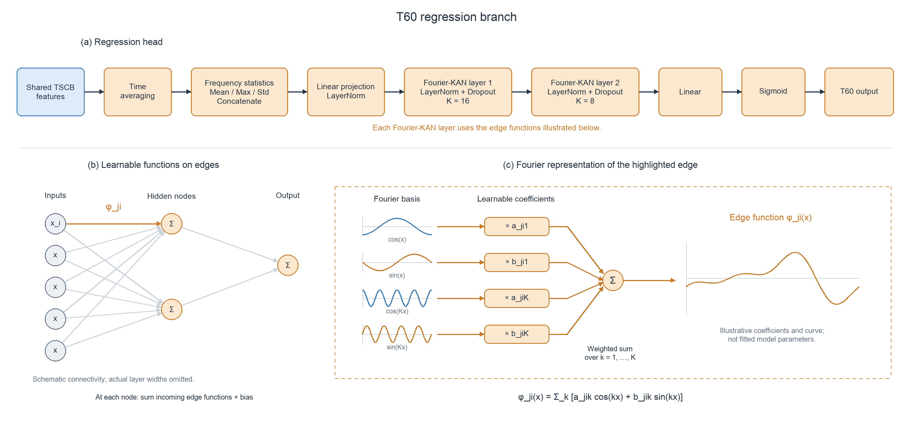
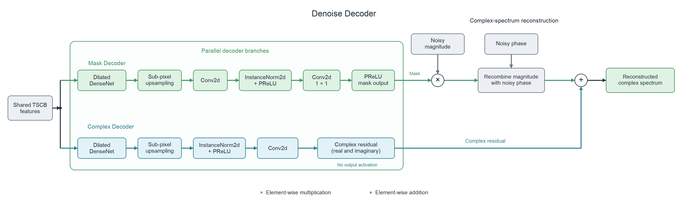
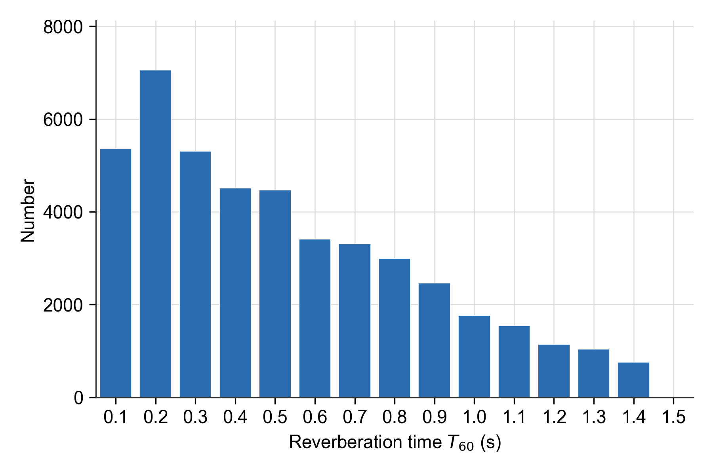
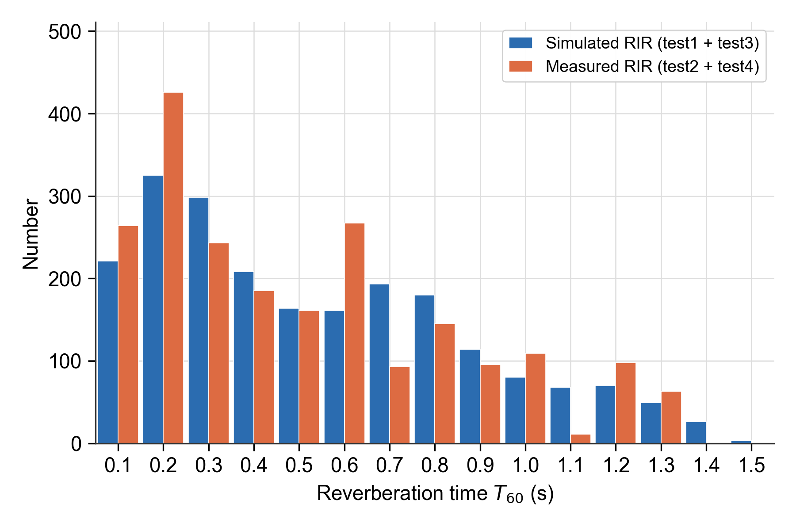
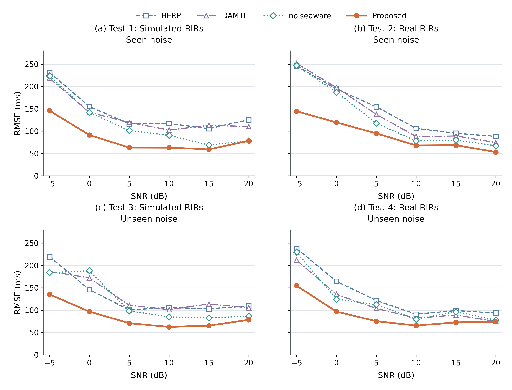
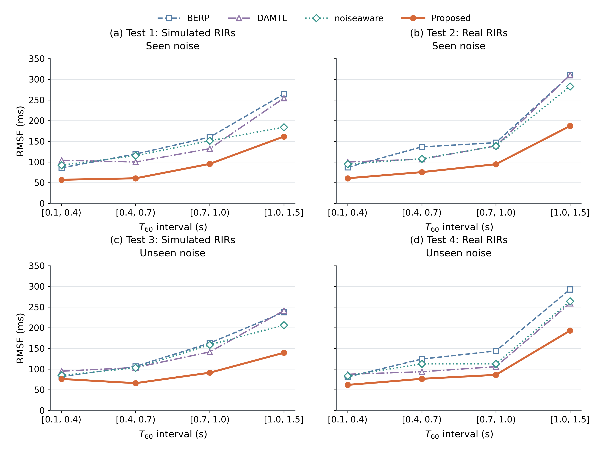

# 去噪辅助监督下的多任务盲混响时间估计：基于 Fourier Kolmogorov–Arnold 回归头的 Conformer 方法

**作者：** 谢欣妮、陆锡堃、桑晋秋（华东师范大学）

> **本文档为中文精修主稿。** 当前按“中文定稿后再生成英文”的流程修订；英文 `docs/main.tex` 与旧版 `docs/main_bilingual.md` 暂未同步本轮修改。
> 主模型和四组交叉消融采用 seed=42 的重训练结果（单任务 KAN 基线 RMSE 111.45 ms）；任务权重扫描保留原实验结果。

---

## 摘要

混响时间 $T_{60}$ 的盲估计在含噪条件下容易受到晚期混响尾掩蔽的影响。为此，我们提出一个多任务学习框架，以 $T_{60}$ 回归为主任务，以去噪重建为辅助任务，两个任务共享时频 Conformer 特征提取网络。去噪分支为共享网络提供逐时频点监督，$T_{60}$ 分支则通过 Fourier-KAN 回归头完成非线性读出。在覆盖仿真与真实房间脉冲响应、已见与未见噪声的四个测试集上，所提模型取得平均 RMSE 92.32 ms、MAE 55.08 ms 和 Pearson 相关系数 0.9630；与单任务基线相比，RMSE 降低 17.2%。Fourier-KAN 回归头在相同多任务设置下优于 MLP 回归头。

**关键词：** 盲混响时间估计、多任务学习、去噪辅助监督、Conformer、Kolmogorov–Arnold 网络、Fourier 基、噪声鲁棒性

---

## 1 引言

当声源在一个封闭空间中发声时，接收端不仅捕获直达声，还会接收到来自周围壁面的大量反射声（Kuttruff 等，2013）。这些反射声随时间衰减，共同构成房间的混响。声源停止后，声能衰减 60 dB 所需的时间被定义为混响时间 $T_{60}$（ISO 3382-2，2008）。作为一个概括房间能量衰减行为的标量，$T_{60}$ 是表征封闭空间声学属性最常用的参数之一，直接影响语音质量、可懂度，以及去混响、语音识别、声源定位、虚拟/增强现实渲染等下游音频应用的性能（Benzeghiba 等，2007；Anthes 等，2016）。标准化测量 $T_{60}$ 的方法包括中断噪声法与积分脉冲响应法（Schroeder，1965），二者均需要全向声源、校准过的传声器与训练有素的操作人员。但这类现场测量既不便携，在大规模或原位测量场景下又成本高昂、实现复杂。因此，*盲*估计方法应运而生：在没有任何专用激励信号或房间几何先验的前提下，直接从录制的语音信号中推断 $T_{60}$（Eaton 等，2016）。

过去二十年间，盲 $T_{60}$ 估计积累了大量工作。传统方法依赖统计信号处理：基于模型的估计器将房间脉冲响应（RIR）的晚期部分建模为阻尼高斯过程（Polack，1988），从能量包络的衰减速率恢复 $T_{60}$；基于特征映射的估计器则从手工设计的声学描述子（如衰减速率的负侧方差、谐波分量的音高强度或谱衰减分布）中推导 $T_{60}$（Ratnam 等，2003；Wen 等，2008；Eaton 等，2013；Falk 等，2010；Löllmann 等，2010）。ACE 挑战赛对这些方法作了系统评测（Eaton 等，2016），同时也暴露出两个反复出现的困难：（i）多数估计器受加性噪声正偏置影响，因为类噪声的混响尾被埋没在噪声之中；（ii）解析衰减模型在非平稳或低信噪比（SNR）场景下十分脆弱。即便是带噪声鲁棒性改进的版本，如谱衰减分布估计器（噪声鲁棒且计算量更低，Eaton 等，2013）或子带分解估计器（Prego 等，2015），仍需要一个相对准确的噪声水平先验估计，而噪声非平稳时这本身就是一个难题。可见，加性噪声对混响尾的掩蔽是盲 $T_{60}$ 估计的核心障碍，如何在含噪条件下稳健地恢复衰减结构，成为后续方法反复面对的问题。

深度学习随后成为一种数据驱动的替代方案。Gamper 等（2018）将 log-mel 特征送入一个六层卷积网络，赢得 ACE 单通道赛道；Xiong 等（2018）将 $T_{60}$ 与早期混响比的联合估计建模为时频特征上的分类问题；Deng 等（2020）引入卷积循环网络以在变长语音上在线估计；Srivastava 等（2021）将该框架推广到多通道输入；Götz 等（2023）用三种卷积循环变体处理动态声学条件下的参数估计；Saini 等（2023）证明 MobileViT 风格的 transformer 可在智能手机上实时运行，而 Duangpummet 等（2022）则从全频带 $T_{60}$ 走向 $T_{60}$、早期衰减时间、清晰度与语音传输指数的联合估计。这些模型虽在网络结构上各异，却大多沿用同一种回归器设计，即在时频特征提取网络 之上堆叠若干全连接层，将聚合后的特征映射为标量 $T_{60}$。为提升含噪条件下的鲁棒性，一类工作进一步借助去噪来辅助 $T_{60}$ 估计：Zheng 等（2022）用两阶段框架先分离出无噪混响语音再据此估计 $T_{60}$，但两阶段分别训练，去噪梯度无法直接优化 $T_{60}$ 所依赖的特征；Zhang 等（2024）则将去噪作为辅助任务与 $T_{60}$ 回归共享 特征提取网络 端到端联合训练，观察到去噪能改善 $T_{60}$ 估计，但其 特征提取网络 相对简单。

尽管上述数据驱动模型在干净或高 SNR 条件下明显优于统计信号处理基线，但在噪声条件下仍存在挑战。晚期混响尾在能量上天然偏弱，易被真实噪声掩蔽，估计精度在低 SNR 或未见噪声场景下仍明显下降；仅依靠特征提取网络自身容量来获得噪声鲁棒性，未必能够促使共享层学习与衰减结构相关的精细时频特征。

为解决上述问题，我们构建一个共享时频 Conformer 特征提取网络的多任务框架。去噪辅助任务提供逐时频点监督，使共享层能够利用含噪频谱中的重建信息。为了增强共享特征到标量 $T_{60}$ 的非线性读出能力，我们进一步采用 Fourier-KAN 回归头，并通过回归头消融与 MLP 进行比较。

本文的主要贡献总结如下。

1. 我们提出一个面向盲 $T_{60}$ 估计的多任务框架：以 $T_{60}$ 回归为主任务、去噪重建为辅助任务，共享 时频 Conformer 共享特征提取网络（稠密卷积编码器与两个时频 Conformer 块），并在共享时频特征之上分出 Fourier-KAN 回归头与 CMGAN 风格去噪解码分支。与先前将去噪与 $T_{60}$ 估计相结合的工作相比，本文以端到端联合训练的方式，将去噪辅助监督引入 时频 Conformer 共享特征提取网络，并配合归一化损失与任务权重调控，使去噪辅助任务参与共享网络的优化。
2. 我们构建了一个 Fourier 基 Kolmogorov–Arnold 回归头，以两层 Fourier-KAN（各层使用不同数量的三角基）将多统计量池化特征映射到 $T_{60}$。实验证实，在相同多任务设置下该头优于常规 MLP 回归头。
3. 我们在覆盖仿真/真实 RIR 与已见/未见噪声类型所有组合的四个含噪混响测试集上作系统评估，验证所提模型相比单任务基线及 BERP、DAMTL、noiseaware 等方法的有效性与跨场景稳健性。

本文余下部分组织如下。第 2 节形式化声学信号模型以及 RIR 与 $T_{60}$ 的关系。第 3 节详述所提网络，包括 Conformer 特征提取网络、去噪解码分支、多统计量池化层、Fourier-KAN 回归头以及多任务训练目标。第 4 节介绍数据集、基线与实现细节。第 5 节汇报 $T_{60}$ 估计与去噪的定量结果、消融实验及任务权重敏感性分析。第 6 节总结全文。

---

## 2 信号模型

### 2.1 声学信号模型

设 $s(t)$ 为位置固定的声源发出的无混响语音，$h(t)$ 为从声源位置到传声器的房间脉冲响应（RIR），$n(t)$ 为传声器处捕获的互不相关加性噪声。在时域上，录制的含噪混响信号 $y(t)$ 建模为

$$
y(t) = s(t)\ast h(t) + n(t), \tag{1}
$$

其中 $\ast$ 表示卷积。对式 (1) 作短时傅里叶变换得到 $Y(k,l) \approx S(k,l)\,H(k,l) + N(k,l)$，其中 $k$、$l$ 分别索引频点与时间帧。盲 $T_{60}$ 估计旨在学习一个映射 $\mathcal{F}:Y \mapsto \hat{T}_{60}$，仅以录制信号的复 STFT 作为输入，无法访问 $S$、$H$ 或 $N$。

### 2.2 混响时间与 Polack 模型

要从观测信号 $y(t)$ 估计 $T_{60}$，需要理解 $T_{60}$ 与 RIR $h(t)$ 结构之间的关系。在 Polack 模型下（Polack，1988），晚期 RIR 被描述为零均值阻尼高斯过程，

$$
h(t) = b(t)\, e^{-\delta t},\qquad t\geq 0, \tag{2}
$$

其中 $b(t)$ 是方差为 $\sigma_b^{2}$ 的零均值平稳白噪声过程，$\delta>0$ 为房间的阻尼常数。由式 (2) 的二阶统计可得均方能量包络的衰减规律

$$
\mathbb{E}\{|h(t)|^{2}\} = \sigma_b^{2}\,e^{-2\delta t}, \tag{3}
$$

由能量衰减 60 dB 的定义，即 $10\log_{10} e^{-2\delta T_{60}} = -60$，可解得混响时间的解析表达式

$$
T_{60} = \frac{3\ln 10}{\delta}. \tag{4}
$$

基于模型的估计器通过对（估计得到的）能量包络取对数后作线性回归来拟合衰减速率 $\delta$。然而当混响语音被噪声污染时，包络不再为纯指数，$\delta$ 的估计会产生严重偏置，通常导致 $T_{60}$ 被高估（Gaubitch 等，2012）。这一局限正是使用数据驱动方法、直接学习从 $Y(k,l)$ 到 $\hat{T}_{60}$ 映射的动机。

---

## 3 所提方法

### 3.1 Proposed multitask framework

如图 1 所示，本文构建一个以 $T_{60}$ 估计为主任务、去噪重建为辅助任务的多任务框架。含噪混响语音经短时傅里叶变换（STFT）后，由稠密卷积编码器和两个串联的时频 Conformer 块（TSCB）提取共享时频特征。网络在共享特征处划分为去噪分支和 $T_{60}$ 回归分支，两条分支分别完成频谱重建和混响时间估计。

去噪分支用幅度掩码与复数残差结构（Cao 等，2022），重建频谱并通过逆短时傅里叶变换（iSTFT）得到去噪语音。该任务以无噪混响语音为重建目标，在去除加性噪声的同时保留混响。$T_{60}$ 分支直接读取共享特征，经统计量池化和 Fourier-KAN 回归头得到混响时间估计，不以去噪分支输出的语音作为输入。

两个任务在训练时共同更新共享特征提取网络，使其同时接受频谱重建与 $T_{60}$ 回归的监督；各分支的专属参数由对应任务损失优化。图 1 仅展示整体模块和输入输出关系，编码器、TSCB、回归头和去噪解码器的内部结构将在后续章节中介绍。

**图 1　所提多任务框架。** 含噪混响语音经 STFT 和共享特征提取网络处理后，分别进入上方的去噪辅助分支与下方的 $T_{60}$ 主任务分支。

### 3.2 稠密卷积编码器

稠密卷积编码器将含噪混响波形转化为两任务共享的高维时频表示。所有录音重采样至 16 kHz、转为单声道，并截断到固定长度 4 s，每条语音 $L=64\,000$ 个样本。为使输入统计量与绝对录音电平无关，每个波形 $y[n]$ 乘以能量归一化因子

$$
c = \sqrt{\frac{L}{\sum_{n=0}^{L-1} y^{2}[n]+\varepsilon}},\qquad \tilde{y}[n] = c\,y[n], \tag{5}
$$

其中 $\varepsilon=10^{-8}$ 用于数值稳定，训练与推理采用相同归一化。随后以 $N=400$ 个样本的 Hamming 分析窗、$H=100$ 个样本的帧移计算复 STFT，得到 $T=641$ 帧、$F=201$ 个频点的复频谱。随后对幅度作指数为 $0.3$ 的功率压缩，保持相位不变；记压缩后的复频谱为 $\mathbf{Y}\in\mathbb{C}^{T\times F}$，将其实部与虚部堆叠为双通道张量，并拼接幅度 $|\mathbf{Y}|=\sqrt{\mathrm{Re}(\mathbf{Y})^{2}+\mathrm{Im}(\mathbf{Y})^{2}}$ 作为第三通道，得到输入张量

$$
\mathbf{X}_{\mathrm{in}} = \bigl[\,|\mathbf{Y}|,\; \mathrm{Re}(\mathbf{Y}),\;\mathrm{Im}(\mathbf{Y})\,\bigr] \in\mathbb{R}^{3\times T\times F}. \tag{6}
$$

如图 2 所示，编码器采用三阶段稠密卷积设计。一个逐点卷积首先将三通道输入投影到 $C=64$ 通道，其后接 实例归一化 与 参数化 ReLU（PReLU）。一个深度 $D=4$ 的*膨胀稠密块*随后施加四个级联的 $2\times 3$ 卷积，每个卷积的输入包含该稠密块的原始输入与此前各层输出的通道拼接；第 $d$ 个卷积沿时间轴的膨胀率为 $2^{d-1}$，在控制参数量的同时指数级扩大时间感受野。每个卷积后接 实例归一化 与 PReLU 激活。最后，一个卷积核大小为 $1\times 3$、步长为 $1\times 2$ 的卷积沿频率轴下采样，其后接实例归一化与 PReLU，得到编码器输出特征

$$
\mathbf{F}^{(0)} = \mathrm{Encoder}(\mathbf{X}_{\mathrm{in}}) \in \mathbb{R}^{C\times T\times F'}, \tag{7}
$$

其中 $C=64$、$T=641$、$F'=101$。

**图 2　稠密卷积编码器。** 上方为输入投影、膨胀稠密块与频率下采样的处理流程；下方展示膨胀率为 1、2、4、8 的四层卷积。稠密块在每层之间沿通道拼接原始输入和已有层输出，最终返回第四层输出。图中最后一个卷积的 stride 2 仅作用于频率轴。

### 3.3 时频 Conformer 块

编码器输出特征 $\mathbf{F}^{(0)}$ 随后由 $N=2$ 个串联的时频 Conformer 块处理。Conformer 结合多头自注意力与卷积运算，分别建模序列中的长程依赖和局部模式（Gulati 等，2020）。本文采用沿时间轴和频率轴依次处理特征的结构（Cao 等，2022），以提取跨时间帧的关联和跨频带的依赖。对长度为 $n$、特征维 $d$ 的序列 $\mathbf{Z}\in\mathbb{R}^{n\times d}$，单个 Conformer 由四个带残差连接的子模块组成：

$$
\begin{aligned}
\mathbf{Z}_1 &= \mathbf{Z} + \tfrac{1}{2}\,\mathrm{FFN}_1(\mathbf{Z}),\\
\mathbf{Z}_2 &= \mathbf{Z}_1 + \mathrm{MHSA}(\mathbf{Z}_1),\\
\mathbf{Z}_3 &= \mathbf{Z}_2 + \mathrm{Conv}(\mathbf{Z}_2),\\
\mathbf{Z}_4 &= \mathrm{LayerNorm}\bigl(\mathbf{Z}_3 + \tfrac{1}{2}\,\mathrm{FFN}_2(\mathbf{Z}_3)\bigr),
\end{aligned} \tag{8}
$$

其中 $\mathrm{FFN}_1$、$\mathrm{FFN}_2$ 为两个 采用预归一化的逐位置前馈模块（Swish 激活），$\mathrm{MHSA}$ 为带 Shaw 式相对位置编码（Shaw 等，2018）的多头自注意力模块，$\mathrm{Conv}$ 为带门控线性单元与 批归一化 的深度可分离一维卷积模块。多头自注意力和卷积模块前后各设置一个前馈模块，其残差分支均采用 $1/2$ 的缩放系数，形成 Macaron 式结构。

如图 3 所示，每个 TSCB 依次沿时间轴和频率轴处理输入特征。时间阶段在各频带内建模跨帧依赖，频率阶段在各时间帧内建模跨频带依赖。计算时，将待处理的轴组织为序列维，另一轴并入批次维；两个阶段均采用残差连接，并在输出时恢复特征图的原始形状。经过两个 TSCB 后，得到共享时频特征 $\mathbf{F}^{(N)}\in\mathbb{R}^{C\times T\times F'}$，分别输入 $T_{60}$ 回归头（§3.4）和去噪解码分支（§3.5）。此处省略批次维，$C$、$T$ 和 $F'$ 分别表示通道数、时间帧数和下采样后的频点数。

**图 3　时频 Conformer 块（TSCB）。** (a) 时间与频率 Conformer 依次处理共享特征，两个阶段均具有外部残差连接；(b) 单个 Conformer 内部的前馈、自注意力和卷积模块及其残差连接。时间与频率 Conformer 采用相同结构，但参数独立。

### 3.4 $T_{60}$ 回归头

$T_{60}$ 回归头的结构如图 4 所示。它先聚合共享时频特征 $\mathbf{F}^{(N)}$，再通过 Fourier-KAN 输出归一化 $T_{60}$ 估计。首先沿时间轴求平均：

$$
\mathbf{Z}_{c,f} = \frac{1}{T}\sum_{t=1}^{T}\mathbf{F}^{(N)}_{c,t,f}, \tag{9}
$$

得到 $\mathbf{Z}\in\mathbb{R}^{C\times F'}$。随后由多统计量池化层沿频率维计算均值、最大值与标准差，并将三者拼接：

$$
\mathbf{e} = \bigl[\,\mu(\mathbf{Z}),\; \max(\mathbf{Z}),\;\sigma(\mathbf{Z})\,\bigr] \in \mathbb{R}^{3C}. \tag{10}
$$

三个统计量分别概括时间平均后各通道特征沿频率轴的平均水平、峰值和变化程度，拼接后得到固定维度的特征向量。

**Fourier-KAN 映射。** 为将池化特征映射为 $T_{60}$ 估计值，回归头采用基于 Fourier 基函数的 KAN 层（Liu 等，2024；Li 等，2025）。每个输出由输入分量经可学习一元函数变换后求和得到：

$$
y_j = \sum_{i=1}^{d_{\mathrm{in}}} \phi_{j,i}(x_i) + b_j,
\qquad j=1,\ldots,d_{\mathrm{out}}, \tag{11}
$$

其中，$d_{\mathrm{in}}$ 和 $d_{\mathrm{out}}$ 分别为输入与输出维度，$b_j$ 为输出偏置。$\phi_{j,i}$ 由 $K$ 组正弦与余弦基函数的加权和表示：

$$
\phi_{j,i}(x_i) = \sum_{k=1}^{K}
\bigl[a_{j,i,k}\cos(kx_i)+c_{j,i,k}\sin(kx_i)\bigr]. \tag{12}
$$

$a_{j,i,k}$、$c_{j,i,k}$ 为可学习系数，$K$ 为基函数阶数，每阶包含一个正弦项和一个余弦项。我们的回归头由线性投影、两层 Fourier-KAN 和一个线性输出层组成。

**投影。** 池化特征向量经线性投影与层归一化，得到 $d_0$ 维向量，

$$
\mathbf{u}^{(0)} = \mathrm{LayerNorm}\bigl(\mathbf{W}_{p}\,\mathbf{e}+\mathbf{b}_{p}\bigr), \qquad \mathbf{u}^{(0)}\in\mathbb{R}^{d_{0}}. \tag{13}
$$

**Fourier-KAN 块。** 投影后的特征依次经两层 Fourier-KAN 处理。第 $\ell$ 层将输入维度 $d_{\ell-1}$ 映射为 $d_\ell$，采用基函数阶数 $K_\ell$。对 $\ell=1,2$，其计算为：

$$
u^{(\ell)}_j = \sum_{i=1}^{d_{\ell-1}}\sum_{k=1}^{K_\ell} \bigl[a^{(\ell)}_{j,i,k}\cos(k u^{(\ell-1)}_i) + c^{(\ell)}_{j,i,k}\sin(k u^{(\ell-1)}_i)\bigr] + b^{(\ell)}_j, \tag{14}
$$

每层输出再经层归一化与 dropout 处理：

$$
\mathbf{u}^{(\ell)} \leftarrow \mathrm{Dropout}\bigl(\mathrm{LayerNorm}(\mathbf{u}^{(\ell)})\bigr). \tag{15}
$$

**输出。** 一个线性层将 $\mathbf{u}^{(2)}\in\mathbb{R}^{d_2}$ 映射为标量，经 sigmoid 得到归一化估计

$$
\hat{T}_{60}^{\mathrm{norm}} = \sigma\bigl(\mathbf{w}_{o}^{\top}\mathbf{u}^{(2)} + b_{o}\bigr) \in (0,1). \tag{16}
$$

**图 4　$T_{60}$ 回归分支。** (a) 时间平均、频率统计量池化、线性投影、两层 Fourier-KAN 与输出映射；(b) KAN 连接关系示意，五个输入节点仅用于说明边函数与节点聚合，不代表实际层宽；(c) 高亮边函数由不同频率的正弦、余弦基函数经可学习系数加权求和构成。曲线为示意，并非训练得到的函数。图中的正弦系数 $b_{j,i,k}$ 对应式 (12) 的 $c_{j,i,k}$。

### 3.5 去噪解码分支

去噪解码分支将共享时频特征 $\mathbf{F}^{(N)}$ 映射为去噪语音，为共享特征提取网络提供重建监督。其目标为无噪混响语音 $\tilde{s}(t)=s(t)\ast h(t)$，经与输入一致的能量归一化处理（见式 (5)），其经相同功率压缩后的复频谱记为 $\tilde{S}$。该辅助任务以去除加性噪声、保留混响成分为重建目标，与本文的混响时间估计任务相对应。

如图 5 所示，去噪分支由幅度掩码解码器和复数残差解码器组成，通过两条互补路径完成复频谱重建（Cao 等，2022）。幅度掩码路径对输入幅度谱进行调整，复数残差路径则对重组后的复频谱进行补偿。两条路径分别包含膨胀稠密块和沿频率轴的子像素上采样模块，用于处理共享特征并恢复频率分辨率，其参数彼此独立。幅度掩码解码器输出掩码 $\mathbf{M}\in\mathbb{R}^{1\times T\times F}$，与输入的压缩幅度谱逐元素相乘，得到 $\hat{A}=|\mathbf{Y}|\odot\mathbf{M}$；复数残差解码器输出双通道残差 $\Delta\in\mathbb{R}^{2\times T\times F}$，分别对应实部 $\Delta_{\mathrm{re}}$ 和虚部 $\Delta_{\mathrm{im}}$。掩码输出采用逐频率参数化的 PReLU，复数残差输出层不设置激活函数，以允许实部和虚部残差取正值或负值。

将掩蔽后的幅度与输入相位 $\angle\mathbf{Y}$ 组合，再叠加复数残差，得到重建压缩频谱 $\hat{\mathbf{Y}}$：

$$
\hat{Y}_{\mathrm{re}} = \hat{A}\cos(\angle\mathbf{Y}) + \Delta_{\mathrm{re}},\qquad
\hat{Y}_{\mathrm{im}} = \hat{A}\sin(\angle\mathbf{Y}) + \Delta_{\mathrm{im}}, \tag{17}
$$

对该频谱进行功率反压缩，并通过 iSTFT 得到去噪语音 $\hat{s}(t)$。去噪分支与 T60 估计分支共同连接共享特征，其重建误差通过第 3.6 节定义的联合损失参与网络优化。

**图 5　去噪解码分支。** 共享 TSCB 特征分别输入幅度掩码解码器与复数残差解码器。掩码与含噪幅度逐元素相乘，结合含噪相位重组成初始复谱，再与复数残差逐元素相加。图中乘法和加法节点分别表示这两种运算；复数残差的两个通道对应实部与虚部。图示运算位于功率压缩域，反压缩与 iSTFT 位于重建复谱之后。

### 3.6 损失函数

为匹配式 (16) 中 sigmoid 的输出范围，每个真值 $T_{60}$ 在送入损失前线性映射到 $[0,1]$：

$$
T_{60}^{\mathrm{norm}} = \frac{T_{60} - T_{\min}}{T_{\max} - T_{\min}}. \tag{18}
$$

$T_{60}$ 回归损失为 $B$ 条语音小批量上预测与真值归一化 $T_{60}$ 之间的均方误差：

$$
\mathcal{L}_{T_{60}}(\boldsymbol{\theta}) = \frac{1}{B}\sum_{i=1}^{B}\bigl(\hat{T}_{60,i}^{\mathrm{norm}} - T_{60,i}^{\mathrm{norm}}\bigr)^{2}. \tag{19}
$$

去噪损失结合压缩域实/虚部损失、幅度损失与时域损失：

$$
\mathcal{L}_{\text{den}} = w_{ri}\,\mathcal{L}_{ri} + w_{mag}\,\mathcal{L}_{mag} + w_{time}\,\mathcal{L}_{time}, \tag{20}
$$

其中 $\mathcal{L}_{ri}$、$\mathcal{L}_{mag}$ 分别为（功率压缩后）增强频谱实/虚部与幅度相对无噪混响目标 $\tilde{S}$ 的均方误差，$\mathcal{L}_{time}$ 为 iSTFT 增强波形与 $\tilde{s}$ 的 $\ell_{1}$ 损失。

由于去噪损失与 $T_{60}$ 损失的原始量级不同，直接加权时权重 $\alpha/\beta$ 难以直观反映两任务对共享层的相对贡献。为使两损失能在同一尺度上加权，我们将二者各自除以自身的指数移动平均（EMA）归一到单位量级，记为 $\mathcal{L}_{\text{den}}^{*}$、$\mathcal{L}_{T_{60}}^{*}$，总损失为

$$
\mathcal{L}(\boldsymbol{\theta}) = \alpha\,\mathcal{L}_{\text{den}}^{*}(\boldsymbol{\theta}) + \beta\,\mathcal{L}_{T_{60}}^{*}(\boldsymbol{\theta}), \tag{21}
$$

其中 $\boldsymbol{\theta}$ 收集共享 编码器 与 TSCB、Fourier-KAN 头及两个去噪解码器的所有可训练参数。损失权重与主模型配置见 §4.3。

推理时将 sigmoid 输出按式 (18) 的逆映射反归一化，得到最终估计 $\hat{T}_{60}\in[T_{\min}, T_{\max}]$。

---

## 4 实验

### 4.1 数据集

实验数据集由 16 kHz 单声道、约 4 秒的含噪混响语音片段组成，$T_{60}$ 覆盖 $[0.1, 1.5]$ s，SNR 覆盖 $-5$ 至 $20$ dB。数据集包含训练集 $40\,000$ 条、验证集 $5\,136$ 条，以及四个各含 $1\,080$ 条的测试集，构成仿真/真实 RIR 与已见/未见噪声的 $2\times 2$ 设计：

**表 1　测试集设计：仿真/真实 RIR 与已见/未见噪声的组合。**

| 测试集 | RIR | 噪声 |
|---|---|---|
| test1 | 仿真（image-source 法） | 已见 |
| test2 | 真实（实测脉冲响应） | 已见 |
| test3 | 仿真（image-source 法） | 未见 |
| test4 | 真实（实测脉冲响应） | 未见 |

其中“已见/未见”指噪声类型是否在训练集中出现。该设计用于评估模型在不同 RIR 真实度与噪声泛化条件下的稳健性。图 6 给出了训练池与测试集（按 RIR 类型）的 $T_{60}$ 分布。

### 4.2 对比方法与评估指标

#### 4.2.1 对比方法

本文选取 BERP、DAMTL 和 noise-aware 三种方法作为对照，均采用第 4.1 节所述的数据划分进行重新训练与评估，并比较其 $T_{60}$ 估计性能。

BERP（Wang 等，2025）是一种通用的盲房间参数估计框架，通过结合注意力机制与卷积层的共享编码器提取房间特征，并利用独立的参数预测器估计不同房间参数。本文将其作为从含噪混响语音中学习房间特征并进行参数回归的对照方法。

DAMTL（Zhang 等，2024）以去噪为辅助任务，通过联合学习去噪重建与 $T_{60}$ 估计提高含噪条件下的估计精度。该方法与本文具有相近的主辅任务设置，是比较去噪辅助多任务框架的直接参照。

noise-aware 时频掩蔽方法（Zheng 等，2022）采用两阶段框架，第一阶段估计无噪混响语音和噪声信息，第二阶段利用这些信息进行 $T_{60}$ 估计。该方法用于比较先进行噪声分离、再估计混响时间的处理方式与本文共享特征联合学习方式的表现。

#### 4.2.2 $T_{60}$ 估计指标

**均方根误差（RMSE）。** RMSE 衡量 $T_{60}$ 估计值与真值之间的总体误差，对较大偏差赋予更高的惩罚，其定义为

$$
\mathrm{RMSE}=\sqrt{\frac{1}{N}\sum_{i=1}^{N}(\hat{T}_{60,i}-T_{60,i})^{2}}, \tag{22}
$$

其中，$N$ 为样本数，$\hat{T}_{60,i}$ 和 $T_{60,i}$ 分别为第 $i$ 个样本的估计值与真值。

**平均绝对误差（MAE）。** MAE 表示测试样本上估计值与真值的平均绝对偏差，定义为

$$
\mathrm{MAE}=\frac{1}{N}\sum_{i=1}^{N}|\hat{T}_{60,i}-T_{60,i}|, \tag{23}
$$

RMSE 和 MAE 均以毫秒报告，数值越小表示估计误差越小。

**Pearson 相关系数（PCC）。** PCC 衡量估计值与真值的线性相关程度，作为误差指标的补充。其取值范围为 $[-1,1]$，越接近 1 表示正线性相关程度越高，计算式为

$$
r=\frac{\sum_{i=1}^{N}(\hat{T}_{60,i}-\bar{\hat{T}}_{60})(T_{60,i}-\bar{T}_{60})}{\sqrt{\sum_{i=1}^{N}(\hat{T}_{60,i}-\bar{\hat{T}}_{60})^{2}}\sqrt{\sum_{i=1}^{N}(T_{60,i}-\bar{T}_{60})^{2}}}, \tag{24}
$$

其中，$\bar{\hat{T}}_{60}$ 和 $\bar{T}_{60}$ 分别为估计值与真值的样本均值。

**决定系数（$R^{2}$）。** $R^{2}$ 以真实值的样本均值为预测基准，评价模型的拟合表现，越接近 1 表示拟合越好，定义为

$$
R^{2}=1-\frac{\sum_{i=1}^{N}(\hat{T}_{60,i}-T_{60,i})^{2}}{\sum_{i=1}^{N}(T_{60,i}-\bar{T}_{60})^{2}}. \tag{25}
$$

主对比结果在各测试集上分别计算后取算术平均，并进一步按 SNR 和 $T_{60}$ 分组分析 RMSE。

#### 4.2.3 去噪质量指标

采用三项常用客观指标评价去噪语音的质量。宽带 PESQ（ITU-T P.862.2）用于评价感知语音质量，STOI（[Taal 等，2011](https://doi.org/10.1109/TASL.2011.2114881)）用于评价语音可懂度，尺度不变信号失真比 SI-SDR（Le Roux 等，2019）用于评价信号重建保真度，以 dB 为单位。三项指标均为数值越高表示性能越好。

所有指标均以无噪混响语音为参考，分别对含噪输入和去噪输出计算，提升量为输出指标与输入指标之差。

### 4.3 模型与训练设置

所提模型的结构参数汇总于表 2。共享特征提取网络采用两个 TSCB，Fourier-KAN 回归头使用两层映射，基函数阶数依次为 16 和 8。

**表 2　网络结构与正则化配置**

| 模块 | 配置项 | 取值 |
|---|---|---|
| 共享特征提取网络 | 通道数 $C$；TSCB 数量 | 64；2 |
| 每个 Conformer 块 | 注意力头数；每头维度 | 4；16 |
| 每个 Conformer 块 | 前馈扩展因子；一维卷积核大小 | 4；31 |
| 每个 Conformer 块 | 注意力与前馈模块 dropout 概率 | 0.2 |
| Fourier-KAN 回归头 | 池化维度；投影维度 $d_0$ | 192；64 |
| Fourier-KAN 回归头 | 两层输出维度 $(d_1,d_2)$ | (32,16) |
| Fourier-KAN 回归头 | 基函数阶数 $(K_1,K_2)$ | (16,8) |
| Fourier-KAN 回归头 | 层间 dropout 概率 | 0.1 |
| MLP 回归头（消融） | 输入维度；两层隐层维度 | 192；(128,64) |
| MLP 回归头（消融） | 隐层激活；dropout 概率 | ReLU；0.3 |

Fourier-KAN 各层的正弦和余弦系数采用零均值高斯初始化，标准差为 $1/\sqrt{d_{\ell-1}K_\ell}$，输出偏置初始化为零。去噪损失子权重 $(w_{ri},w_{mag},w_{time})=(0.1,0.9,0.2)$；主模型采用 $(\alpha,\beta)=(1.0,0.05)$，任务权重敏感性分析见 §5.4。

主模型及四组交叉消融均以随机种子 42 从头训练，采用 4 张 GPU、全局批大小 16。所提模型按如下配置训练：采用 AdamW 优化器（学习率 $5\times10^{-4}$、权重衰减 $10^{-5}$），梯度裁剪 $5.0$，混合精度训练，最多 100 个 epoch，验证集 RMSE 连续 15 个 epoch 不下降则早停。按 §3.6 将去噪与 $T_{60}$ 损失各自 EMA 归一化后，以 $\mathcal{L}=\alpha\,\mathcal{L}_{\text{den}}^{*}+\beta\,\mathcal{L}_{T_{60}}^{*}$ 联合训练；任务权重 $(\alpha,\beta)$ 在 §5.4 调优。

---

## 5 结果与讨论

### 5.1 与基线的结果对比

我们将所提模型（归一化主模型，去噪主导档 $\alpha=1.0,\beta=0.05$，训练设置见 §4.3）与三种盲 $T_{60}$ 估计方法（BERP、noiseaware、DAMTL）及单任务消融基线，在同一数据集的四个测试集上对比，各测试集指标及其均值见表 3。

**表 3　四个测试集及其平均结果。RMSE/MAE 单位为 ms；四集均值为各测试集指标的算术平均。各组各指标最优值加粗。**

| 测试集 | 方法 | RMSE ↓ | MAE ↓ | PCC ↑ | R² ↑ |
|---|---|---:|---:|---:|---:|
| **Test 1 · 仿真／已见** | BERP | 148.22 | 91.70 | 0.9028 | 0.8104 |
|  | DAMTL | 140.08 | 85.95 | 0.9125 | 0.8307 |
|  | noiseaware | 128.80 | 83.87 | 0.9260 | 0.8569 |
|  | 单任务 KAN | 108.41 | 66.99 | 0.9484 | 0.8986 |
|  | 本文 | **88.79** | **51.78** | **0.9660** | **0.9320** |
| **Test 2 · 真实／已见** | BERP | 158.33 | 95.05 | 0.8909 | 0.7839 |
|  | DAMTL | 154.20 | 94.49 | 0.8934 | 0.7950 |
|  | noiseaware | 145.44 | 86.16 | 0.9046 | 0.8177 |
|  | 单任务 KAN | 122.46 | 74.95 | 0.9337 | 0.8707 |
|  | 本文 | **96.96** | **58.35** | **0.9593** | **0.9190** |
| **Test 3 · 仿真／未见** | BERP | 137.53 | 86.46 | 0.9176 | 0.8374 |
|  | DAMTL | 136.12 | 85.57 | 0.9179 | 0.8408 |
|  | noiseaware | 129.50 | 80.85 | 0.9255 | 0.8559 |
|  | 单任务 KAN | 105.76 | 67.14 | 0.9517 | 0.9039 |
|  | 本文 | **88.58** | **54.78** | **0.9669** | **0.9326** |
| **Test 4 · 真实／未见** | BERP | 144.71 | 89.58 | 0.9069 | 0.8169 |
|  | DAMTL | 125.38 | 78.27 | 0.9299 | 0.8625 |
|  | noiseaware | 130.92 | 78.65 | 0.9223 | 0.8501 |
|  | 单任务 KAN | 109.16 | 67.57 | 0.9469 | 0.8958 |
|  | 本文 | **94.95** | **55.42** | **0.9599** | **0.9212** |
| **四集均值** | BERP | 147.20 | 90.70 | 0.9046 | 0.8122 |
|  | DAMTL | 138.94 | 86.07 | 0.9134 | 0.8323 |
|  | noiseaware | 133.66 | 82.38 | 0.9196 | 0.8451 |
|  | 单任务 KAN | 111.45 | 69.16 | 0.9452 | 0.8923 |
|  | 本文 | **92.32** | **55.08** | **0.9630** | **0.9262** |

所提模型在四个测试集（test1–4 = 仿真/真实 RIR × 已见/未见噪声）上均优于三种对比方法与单任务基线，RMSE 相比单任务基线降低 17.2%（92.32 ms vs 111.45 ms），验证了"去噪辅助任务 + 归一化多任务训练"的有效性与跨场景稳健性。

### 5.2 信噪比对估计精度的影响

图 7 比较了各方法在四个测试集、六种 SNR 条件下的估计性能。总体而言，随着 SNR 提高，各方法的 RMSE 呈下降趋势，表明噪声水平是影响 $T_{60}$ 估计精度的重要因素。低 SNR 条件下，各方法的估计误差均较大；在较高 SNR 条件下，误差总体较低。

本文方法在大多数 SNR 条件下取得最低 RMSE，且在低 SNR 下的优势较为突出。在 −5 dB 条件下，相比各测试集中表现最好的对比方法，本文方法的 RMSE 降低约 26.5%–41.3%。随着 SNR 提高，本文方法与部分对比方法的差距缩小，例如在图 7(a) 的 20 dB 条件下，本文方法与 noiseaware 的 RMSE 分别为 78.41 ms 和 78.29 ms，表现接近。这些结果表明，本文模型的优势主要体现在噪声较强的条件下。

如图 7(c)、(d) 所示，在未见噪声条件下，本文方法在各 SNR 条件下均取得最低 RMSE，表明其相对于对比方法的优势能够延续至未见噪声场景。

**图 7　信噪比对估计精度的影响。** (a) Test 1：仿真 RIR、已见噪声；(b) Test 2：真实 RIR、已见噪声；(c) Test 3：仿真 RIR、未见噪声；(d) Test 4：真实 RIR、未见噪声。SNR 分别为 −5、0、5、10、15 和 20 dB，各点为相应测试集内该 SNR 下 180 条样本的 RMSE。

### 5.3 混响时间对估计精度的影响

图 8 按真实 $T_{60}$ 将各测试集划分为四个区间，比较不同混响条件下的估计误差。各方法的 RMSE 总体上在长混响区间较高，其中 $T_{60}\in[1.0,1.5]$ s 时，四个测试集中的所有方法均取得各自最高的分组 RMSE。本文方法在 $[0.1,0.4)$ s 区间的 RMSE 为 57.1–76.0 ms，在 $[1.0,1.5]$ s 区间增至 139.4–192.9 ms，表明长混响条件仍是当前模型的主要误差来源之一。

本文方法在四个测试集的全部 $T_{60}$ 分组中均取得最低 RMSE，在长混响区间也保持了这一优势。以真实 RIR 条件为例，Test 2 中本文方法的 RMSE 为 187.2 ms，而三种对比方法为 282.9–310.3 ms；Test 4 中本文方法为 192.9 ms，对比方法为 258.9–292.5 ms。这说明本文模型在较长混响时间下仍能降低估计误差，但尚未消除长混响与短混响条件之间的精度差距。

进一步比较 RIR 类型，在 $[1.0,1.5]$ s 区间，本文方法在真实 RIR 测试集上的 RMSE 高于相应噪声条件下的仿真 RIR 测试集：已见噪声下为 187.2 ms 与 161.7 ms，未见噪声下为 192.9 ms 与 139.4 ms。其余三种方法在该区间也呈现相同的差异方向，而在较短混响区间，仿真与真实 RIR 之间没有一致的高低关系。因此，结果所反映的困难主要集中在真实 RIR 的长混响条件，不能简单归结为所有真实 RIR 场景都更难。不同测试集的样本组成并非严格配对，这些比较反映当前测试数据上的性能差异，尚不能单独确定其形成原因。

**图 8　混响时间对估计精度的影响。** 子图 (a)–(d) 的测试场景与图 7 一致。按真实 $T_{60}$ 分为 $[0.1,0.4)$、$[0.4,0.7)$、$[0.7,1.0)$ 和 $[1.0,1.5]$ s 四个区间，各点为相应测试集内该区间样本的 RMSE。横轴为分组区间，连线不表示连续拟合。

### 5.4 消融实验

**任务权重敏感性分析。** 为考察任务权重对联合训练效果的影响，表 4 比较了归一化损失 $\mathcal{L}=\alpha\,\mathcal{L}_{\text{den}}^{*}+\beta\,\mathcal{L}_{T_{60}}^{*}$ 下的七组权重配置。在所考察的配置中，$(\alpha,\beta)=(1.0,0.05)$ 取得最低 RMSE，为 92.91 ms。当 $\alpha=1.0$ 时，将 $\beta$ 进一步减小至 0.02 或 0.01，RMSE 分别为 102.83 ms 和 95.65 ms，均未获得进一步改善。这表明联合训练的效果受到任务权重设置的影响，增加去噪损失的相对权重并非总能提高 $T_{60}$ 估计精度。引入去噪辅助任务本身的效果由表 5 的交叉消融进一步检验。

**表 4　任务权重敏感性分析（归一化损失；test1–test4 平均）**

| 配置 | $(\alpha,\beta)$ | RMSE (ms) ↓ | MAE (ms) ↓ |
|---|---|---|---|
| 去噪主导 | (1.0, 0.01) | 95.65 | 61.78 |
| 去噪主导 | (1.0, 0.02) | 102.83 | 67.24 |
| 去噪主导 | (1.0, 0.05) | **92.91** | **56.68** |
| 去噪主导 | (1.0, 0.1) | 97.79 | 57.95 |
| 去噪主导 | (1.0, 0.3) | 107.10 | 64.28 |
| 持平 | (1.0, 1.0) | 109.90 | 67.16 |
| $T_{60}$ 主导 | (0.1, 1.0) | 109.54 | 68.15 |

**任务设置与回归头交叉消融。** 在相同的数据划分、随机种子 42 和全局批大小 16 下，比较单任务／多任务与 MLP／Fourier-KAN 的四种组合。多任务配置采用 $(\alpha,\beta)=(1.0,0.05)$，结果见表 5。

**表 5　任务设置与回归头交叉消融（test1–test4 平均；RMSE/MAE 单位 ms）**

| 编号 | 去噪辅助任务 | 回归头 | RMSE ↓ | MAE ↓ | $r$ ↑ | $R^{2}$ ↑ |
|---|---|---|---:|---:|---:|---:|
| A | 无 | MLP | 118.19 | 73.00 | 0.9383 | 0.8791 |
| B | 有 | MLP | 98.50 | 63.99 | 0.9589 | 0.9161 |
| C | 无 | Fourier-KAN | 111.45 | 69.16 | 0.9452 | 0.8923 |
| D | 有 | Fourier-KAN | **92.32** | **55.08** | **0.9630** | **0.9262** |

**去噪辅助任务的作用。** 如表 5 所示，在 Fourier-KAN 回归头下，引入去噪辅助任务使 RMSE 从 111.45 ms 降至 92.32 ms，降低 17.2%（C 与 D）。在 MLP 回归头下，RMSE 也从 118.19 ms 降至 98.50 ms（A 与 B），表明去噪辅助任务在两种回归头下均有助于提升 $T_{60}$ 估计精度。

**Fourier-KAN 回归头的作用。** 在多任务设置下，将 MLP 替换为 Fourier-KAN 后，RMSE 从 98.50 ms 降至 92.32 ms，降低 6.3%（表 5，B 与 D）。在单任务设置下，Fourier-KAN 同样取得更低的 RMSE，从 MLP 的 118.19 ms 降至 111.45 ms（A 与 C）。

MLP 与 Fourier-KAN 回归头的参数量分别为 33,025 和 86,369，包含投影、可训练归一化参数和输出层，不包含共享特征提取网络与去噪解码分支。两种回归头采用相同的特征池化方式，但隐层结构、参数量和 dropout 配置不同（表 2），因此不能将回归头之间的全部性能差异归因于基函数形式。

### 5.5 去噪结果

表 6 报告原三档任务权重对比实验及 seed=42 主模型的去噪质量（test1–test4 平均）。按 §3.5 定义的目标，这些指标反映在保留混响前提下的噪声去除。

**表 6　原任务权重对比实验及主模型的去噪指标（test1–test4 平均）**

| 配置 | PESQ ↑ | STOI ↑ | SI-SDR (dB) ↑ | ΔSI-SDR |
|---|---|---|---|---|
| 含噪输入 | 2.721 | 0.847 | 15.91 | — |
| $T_{60}$ 主导 | 3.077 | 0.891 | 18.80 | +2.89 |
| 持平 | 3.178 | 0.907 | 19.79 | +3.88 |
| 去噪主导（原权重对比实验） | 3.472 | 0.928 | 21.13 | +5.21 |
| **主模型（seed=42）** | **3.481** | **0.930** | **21.21** | **+5.30** |

主模型相比含噪输入获得 +0.76 PESQ、+0.08 STOI 和 +5.30 dB SI-SDR 的提升。在原任务权重对比实验中，去噪主导配置也取得了三档配置中最好的去噪结果。结合表 4，其去噪质量和 $T_{60}$ 精度均优于所比较的其他权重配置。

---

## 6 结论

本文提出一个面向盲 $T_{60}$ 估计的多任务学习框架，以 $T_{60}$ 回归为主任务、去噪重建为辅助任务，共享时频 Conformer 特征提取网络，并采用 Fourier-KAN 回归头进行 $T_{60}$ 估计。在四个测试集上，所提模型取得平均 RMSE 92.32 ms，相比单任务 KAN 基线降低 17.2%，并优于 BERP、DAMTL 和 noiseaware 等对比方法。交叉消融表明，在 MLP 和 Fourier-KAN 两种回归头下，引入去噪辅助任务均降低了估计误差；在相同多任务设置下，Fourier-KAN 回归头相比 MLP 的 RMSE 降低 6.3%。任务权重分析进一步表明，联合训练的性能受到权重设置的影响，在所考察的配置中，$(\alpha,\beta)=(1.0,0.05)$ 表现最好。

本文仍有若干可拓展之处。其一，在长混响（$T_{60}>1.0$ s）区间，受真实 RIR 中长混响样本相对稀少的影响，各方法的估计误差普遍高于短混响区间，所提模型虽已明显领先，但该区间的精度仍有提升空间；未来可通过针对性的数据增强或重加权缓解这一不平衡。其二，本文聚焦单通道输入，后续可将该多任务框架推广至多通道场景，或与早期衰减时间、清晰度等其他房间声学参数的联合估计相结合。
